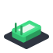
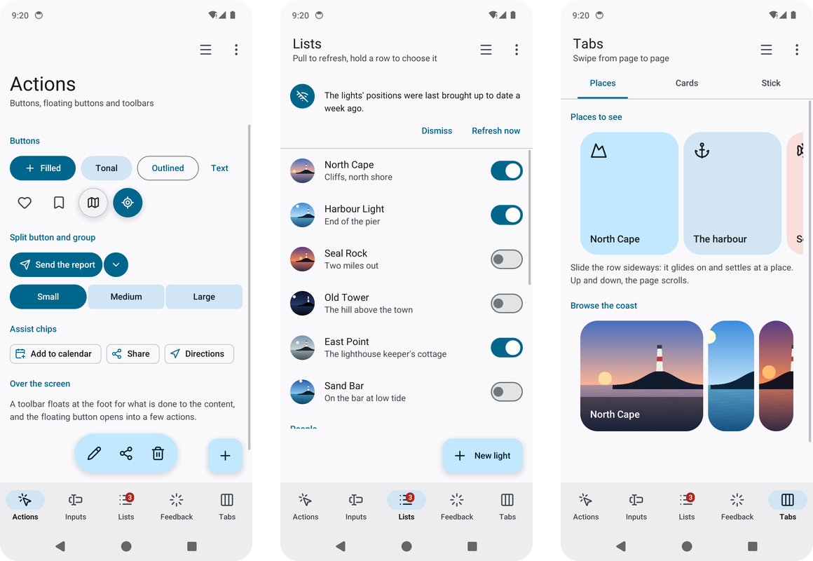
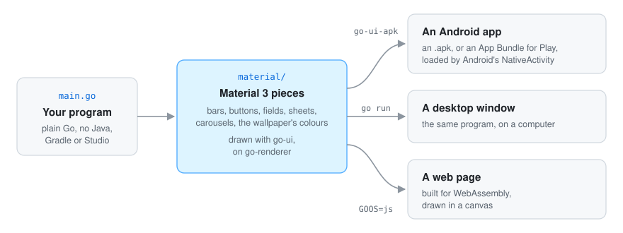

<div align="center">



# Go UI for Android

**Android apps in Go that look like Android's own.** Material Design 3 pieces for
[go-ui](https://github.com/akrck02/go-ui), and a tool that packages a go-ui program as an Android
app: no Java, Gradle or Android Studio. The same program still runs on the desktop and in a web page.

[](go.mod)


[](LICENSE)

</div>

## 🤖 AI disclosure

I write most of my code by hand, so I want to be clear about this project: **it was written by an
AI assistant (Claude, by Anthropic) under my direction, in October 2026.** I decided what to build
and how it should behave; the material package, the go-ui-apk tool, the gallery and the docs were
written by the AI. Every commit made this way carries a `Co-Authored-By: Claude` line.

**Status: pending thorough review.** The code compiles and its tests pass, and the gallery was tried
on phones and the emulator, but I have not yet reviewed it line by line. Treat it as a working
draft, not as code I vouch for.

---

<p align="center">
<picture>
  <source media="(prefers-color-scheme: dark)" srcset="docs/images/hero-dark.png">
  
</picture>
</p>

## ✨ What it looks like

<table>
<tr>
<th width="33%">Fields that type like the phone's</th>
<th width="33%">Expressive's indicators</th>
<th width="33%">Navigation</th>
</tr>
<tr>
<td>
<picture>
  <source media="(prefers-color-scheme: dark)" srcset="docs/images/inputs-dark.png">
  
</picture>
</td>
<td>
<picture>
  <source media="(prefers-color-scheme: dark)" srcset="docs/images/feedback-dark.png">
  
</picture>
</td>
<td>
<picture>
  <source media="(prefers-color-scheme: dark)" srcset="docs/images/drawer-dark.png">
  
</picture>
</td>
</tr>
<tr>
<td>The keyboard suggests words and underlines the one it composes; the eye shows a password.</td>
<td>Shapes that morph, wavy progress and skeletons, drawing only while they move.</td>
<td>A bar, a rail on a wide screen, a drawer, tabs, and the back gesture.</td>
</tr>
<tr>
<td colspan="3" align="center">The wallpaper's colours on Android 12 and later, light or dark with the phone, and readable by TalkBack.</td>
</tr>
</table>

## 🚀 Quick start

```go
dark := window.SystemPrefersDark()
scheme := material.System(dark) // the wallpaper's colours on Android 12 and later
context.Theme = scheme.Theme(dark)
look := material.New(context, scheme)

look.TopAppBar(material.TopBar{Title: "Lighthouses"})
if look.FilledButton("plus", "Add one") { … }
look.NavigationBar(places, &screen)
```

With the Android SDK, the NDK and a JDK installed:

```bash
go run github.com/akrck02/go-ui-android/cmd/go-ui-apk -name Lighthouses -id io.example.lighthouses ./cmd/lighthouses
adb install lighthouses.apk
```

`go run ./cmd/gallery` shows every piece on the desktop. [More on getting started →](docs/2-getting-started.md)

## 🔍 How it works

<p align="center">
  
</p>

Your program stays an ordinary Go `main` package. On Android it is a shared library that Android's
own `NativeActivity` loads; go-ui-apk builds it with the NDK and packs it with the SDK's own tools.
[More on packaging →](docs/4-guides/5-packaging.md)

## 📚 Documentation

| | |
|---|---|
| [Getting started](docs/2-getting-started.md) | The two parts, a program's first lines, and building against go-ui. |
| [Tutorial](docs/3-the-quest/0-the-quest.md) | A lighthouse app in five lessons, from the first screen to a phone. |
| [Components](docs/5-components/0-components.md) | Every piece one by one, with concrete cases. |
| [Reference](docs/6-reference/0-reference.md) | Every type and function of `material`. |
| [The pieces](docs/4-guides/1-pieces.md) | Every piece by Material's catalogue, with pictures. |
| [Colours](docs/4-guides/2-colours.md) | The wallpaper's colours, Material's baseline, a scheme from one colour. |
| [Feeling at home on a phone](docs/4-guides/3-phone.md) | Gestures, the back gesture, turning the phone, notifications, services. |
| [Screen readers](docs/4-guides/4-screen-readers.md) | How TalkBack reads every piece. |
| [Packaging: go-ui-apk](docs/4-guides/5-packaging.md) | From a Go program to an `.apk` or an App Bundle. |
| [The gallery](docs/4-guides/6-gallery.md) | Every piece in one program, and where it was tried. |

## Licence

MIT, see [LICENSE](LICENSE). The material package embeds the Roboto typeface, under the SIL Open
Font License (`material/fonts/OFL.txt`).
