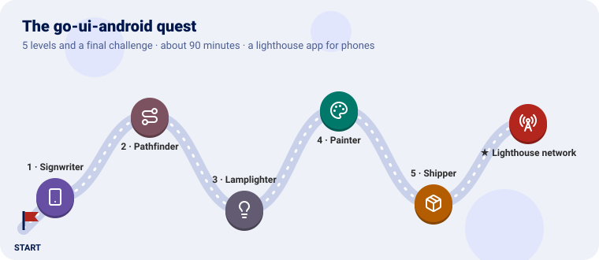
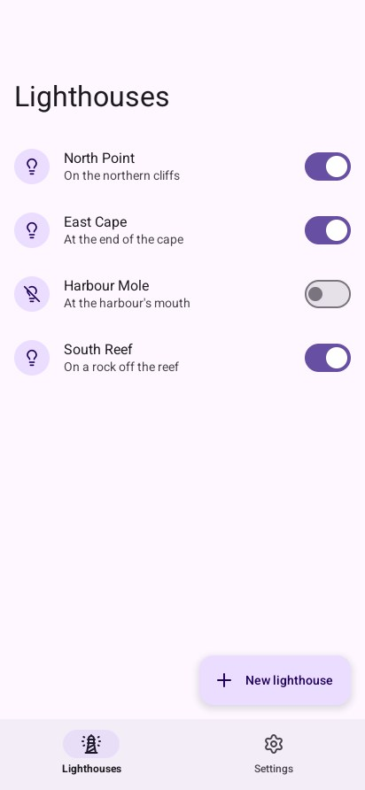
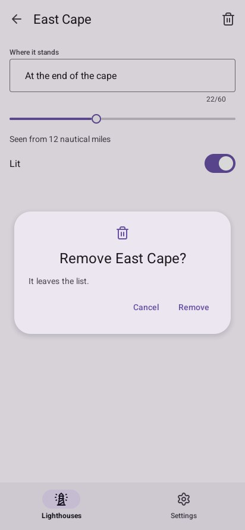

# Tutorial: a lighthouse app for phones

In five lessons you build an Android app in Go that looks and behaves like Android's own: a list
of lighthouses, a screen for each, a dialog before removing one, a note to undo it, settings for
the theme and the colours, and the back gesture. You try it on the desktop as you go, and end with
it installed on a phone.

**Before you start**, know go-ui's basics: [its Get started](https://github.com/akrck02/go-ui/blob/main/docs/2-get-started.md)
and, better, the first lessons of [its tutorial](https://github.com/akrck02/go-ui/blob/main/docs/3-the-quest/0-the-quest.md). This
tutorial uses the same immediate mode, with Material pieces instead of go-ui's own.

Every lesson has the same shape, as in a quest: **the idea** in everyday words, **the code**, a **checkpoint** to know it works, a **bonus** with its solution folded, and an **achievement** to unlock. A final challenge waits at the end of lesson 5.

| Lesson | You learn | You end with |
|---|---|---|
| [1. A first screen](1-a-first-screen.md) | `material.Look`, schemes, the top bar, list items, the floating button | The list, in a phone-sized window |
| [2. Screens and the back gesture](2-screens-and-back.md) | The navigation bar, a stack of screens, `GoBack`, `Back` | A screen for each lighthouse |
| [3. Fields, dialogs and notes](3-fields-dialogs-and-notes.md) | Text fields, sliders, switches, `Dialog`, `Snackbar` | Editing, removing and undoing |
| [4. Colours and settings](4-colours-and-settings.md) | The wallpaper's colours, a scheme from one colour, the dark theme | A settings screen |
| [5. On a phone](5-on-a-phone.md) | The SDK, the NDK, go-ui-apk, the emulator, the log, a release | The app installed |

The whole program is at the end of [lesson 4](4-colours-and-settings.md#the-whole-program).

---

[← Documentation](../1-overview.md) · [Lesson 1 →](1-a-first-screen.md)
