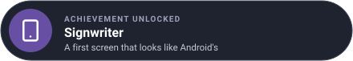

# Lesson 1: a first screen

In this lesson you set the app up and draw its first screen: a large title, a list of lighthouses
with a switch on each, and a floating button to add one.

| Mission | Pieces | Time |
|---|---|---|
| The list, in a phone-sized window | `material.Look`, schemes, `TopAppBar`, `ListItem` | 15 min |

#### The idea

Go UI is the **pencil**; `material` is a **stencil set** cut to Android's own shapes: the same lines, but every bar, row and button comes out the size and colour Android's apps use, so the app feels at home on a phone.

## The module

Clone Go UI for Android beside Go UI and Go Renderer (and Go Sound, which its gallery plays notes
through), then make your module there:

```bash
cd workspace
git clone https://github.com/akrck02/go-ui-android
git clone https://github.com/akrck02/go-sound
mkdir lighthouses && cd lighthouses
go mod init example.com/lighthouses
for module in go-renderer go-ui go-ui-android go-sound; do
	go mod edit -require github.com/akrck02/$module@v0.0.0 -replace github.com/akrck02/$module=../$module
done
```

## The data and `main`

```go
// lighthouse is the program's own data.
type lighthouse struct {
	name, place string
	lit         bool
	rangeNM     float32
}

// app is everything the program remembers between frames.
type app struct {
	lighthouses []lighthouse
	place       int                 // the destination chosen in the navigation bar
	navigation  material.Navigation // the lighthouses' screens: "" is the list, a name its details
	removing    string              // the lighthouse the dialog asks about; "" when it is closed
	removed     *lighthouse         // the last one removed, for the note's Undo
	notes       material.Snackbar
	dark        bool
	ownColour   bool // a teal of the app's own instead of the wallpaper's colours
	added       int
}

// The destinations, in the navigation bar's order.
const (
	lighthousesPlace = iota
	settingsPlace
)

var places = []material.Destination{{Icon: "lighthouse", Label: "Lighthouses"}, {Icon: "settings", Label: "Settings"}}

func main() {
	options := window.Options{Title: "Lighthouses"}
	options.RegisterFlags(flag.CommandLine)
	flag.Parse()

	program := &app{
		lighthouses: []lighthouse{
			{name: "North Point", place: "On the northern cliffs", lit: true, rangeNM: 18},
			{name: "East Cape", place: "At the end of the cape", lit: true, rangeNM: 12},
			{name: "Harbour Mole", place: "At the harbour's mouth", rangeNM: 6},
			{name: "South Reef", place: "On a rock off the reef", lit: true, rangeNM: 15},
		},
		dark: options.Dark || window.SystemPrefersDark(),
	}
	material.UseRoboto() // Android's typeface, before the window reads the fonts
	if err := window.Run(options, program.build); err != nil {
		log.Fatal(err)
	}
}
```

`material.UseRoboto()` draws every text in Roboto, Android's typeface; call it before the window
opens. `window.Options` and `RegisterFlags` are Go UI's: `-width 412 -height 892` gives the window a
phone's size on the desktop, and `-capture` a picture.

## A frame with Material

At every frame the program makes a **scheme** (Material's colour roles), gives Go UI's own
controls its theme, and makes a **`material.Look`**, which draws the pieces:

```go
// build describes the app for this frame.
func (program *app) build(context *ui.Context) {
	scheme := material.System(program.dark) // the wallpaper's colours on Android 12 and later
	if program.ownColour {
		scheme = material.FromColour(draw2d.Hex("#00796b"), program.dark)
	}
	context.Theme = scheme.Theme(program.dark)
	look := material.New(context, scheme)

	defer program.goBack(look) // last: what is over the screen answers the back first
	defer program.overlays(look)

	context.Box(ui.Layout{Direction: ui.Vertical, Width: ui.Grow(), Height: ui.Grow()}, func() {
		look.Body(false, func() {
			switch program.place {
			case lighthousesPlace:
				look.Screens("lighthouses", &program.navigation, func(key string) {
					if key == "" {
						program.list(look)
						return
					}
					program.details(look, key)
				})
			case settingsPlace:
				program.settings(look)
			}
		})
		look.NavigationBar(places, &program.place)
	})
}
```

For now leave out the two `defer` lines, the `settings` case and `details` (lessons 2 to 4), and
draw the list without `look.Screens`. `Body` keeps the content clear of the camera's cutout and the
gesture bar; `NavigationBar` comes in lesson 2.

## The list

```go
// list shows every lighthouse; touching one opens its screen.
func (program *app) list(look material.Look) {
	context := look.Context
	look.TopAppBar(material.TopBar{Title: "Lighthouses", Large: true})
	context.ScrollArea("list", ui.Layout{Direction: ui.Vertical, Width: ui.Grow(), Height: ui.Grow()}, func() {
		for index := range program.lighthouses {
			light := &program.lighthouses[index]
			context.Push(light.name)
			icon := "lightbulb-off"
			if light.lit {
				icon = "lightbulb"
			}
			if look.ListItem("row", material.Item{Icon: icon, Headline: light.name, Supporting: light.place,
				Trailing: func() { look.Switch("lit", &light.lit) }}) {
				program.navigation.Go(light.name)
			}
			context.Pop()
		}
	})
	context.Box(ui.Layout{Width: ui.Grow(), Padding: ui.Pad(16), AlignX: ui.End}, func() {
		if look.ExtendedFloatingButton("plus", "New lighthouse") {
			program.added++
			name := fmt.Sprint("New lighthouse ", program.added)
			program.lighthouses = append(program.lighthouses, lighthouse{name: name, place: "Not placed yet", rangeNM: 10})
			program.navigation.Go(name)
		}
	})
}
```

- `TopAppBar` with `Large` writes the title big, as a screen's first level does on Android.
- `ListItem` is a Material row: an icon in a round avatar, a headline, a supporting line, and
  `Trailing` for what goes at its end. It returns `true` when touched.
- Rows repeat, so each gets a scope with `context.Push` (Go UI's ids).
- `ExtendedFloatingButton` is the floating action button with its action written.

```bash
go run . -width 412 -height 892
```


Sizes are Material's: targets of at least 48 pixels, 16-pixel text. A finger has no hover, so
pieces change only while pressed.

#### Checkpoint

In a 412 × 892 window: *Lighthouses* in large type, four rows with a bulb, a place and a switch, and *New lighthouse* floating at the bottom end.



## Bonus (optional)

Show how many lighthouses are lit in the top bar's subtitle.

<details>
<summary>🔓 Show the solution</summary>

```go
lit := 0
for _, light := range program.lighthouses {
	if light.lit {
		lit++
	}
}
look.TopAppBar(material.TopBar{Title: "Lighthouses", Subtitle: fmt.Sprint(lit, " lit"), Large: true})
```

</details>

---

[← Tutorial](0-the-quest.md) · [Lesson 2: screens and the back gesture →](2-screens-and-back.md)
