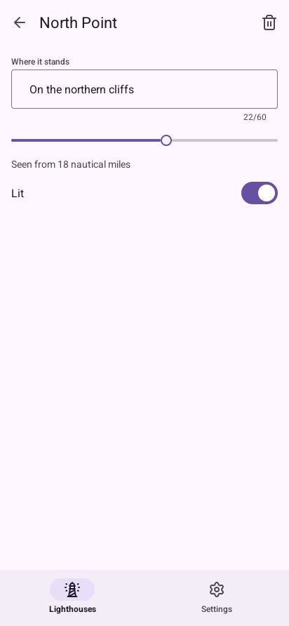

# Lesson 2: screens and the back gesture

A phone app moves between screens: destinations at the bottom, and inside one a stack of screens,
each sliding in over the one before. In this lesson the app gets both, and answers the system's
**back gesture** as Android's own apps do.

| Mission | Pieces | Time |
|---|---|---|
| A screen for each lighthouse | `NavigationBar`, `Navigation`, `Screens`, `GoBack` | 20 min |

#### The idea

Screens stack like **plates**: opening a lighthouse puts its screen on top, and the back gesture takes the top plate off. The navigation bar picks which **pile** you look at.

## Destinations

`NavigationBar(destinations, &selected)` draws three to five destinations at the bottom, under the
gesture bar; it changes `selected` when one is touched:

```go
var places = []material.Destination{{Icon: "lighthouse", Label: "Lighthouses"}, {Icon: "settings", Label: "Settings"}}
```

`build` shows the destination chosen with a `switch`, then the bar (lesson 1's `build`). On a phone
turned on its side, `look.Wide()` is true: draw `NavigationRail` down the left instead, with
`look.Body(true, …)` ([feeling at home on a phone](../4-guides/3-phone.md#turning-the-phone)).

## A stack of screens

A `material.Navigation` is a stack of screen names, kept by the program. `Go(name)` opens one,
sliding in from the right; `Back()` returns. `look.Screens` draws the one on top, by its name:
`""` is the first.

```go
look.Screens("lighthouses", &program.navigation, func(key string) {
	if key == "" {
		program.list(look)
		return
	}
	program.details(look, key)
})
```

The list's rows call `program.navigation.Go(light.name)`. A lighthouse's screen has a top bar with
a back arrow; `TopAppBar` returns `true` when it is touched:

```go
// details is a lighthouse's own screen.
func (program *app) details(look material.Look, name string) {
	light := program.find(name)
	if light == nil { // removed while its screen was still sliding away
		return
	}
	if look.TopAppBar(material.TopBar{Title: light.name, Back: true, Actions: func() {
		if look.NamedIconButton("trash-2", "Remove") {
			program.removing = light.name
		}
	}}) {
		program.navigation.Back()
	}
	look.Context.Box(ui.Layout{Direction: ui.Vertical, Width: ui.Grow(), Padding: ui.Pad(16), Gap: 16}, func() {
		look.TextField("place", &light.place, material.Field{Label: "Where it stands", MaxLength: 60, Counter: true})
		look.Slider("range", &light.rangeNM, 1, 30, 1)
		look.Text(fmt.Sprintf("Seen from %.0f nautical miles", light.rangeNM), 14, draw2d.Regular, look.Scheme.OnSurfaceVariant)
		look.Context.Row(func() {
			look.Text("Lit", 16, draw2d.Regular, look.Scheme.OnSurface)
			look.Context.Spacer()
			look.Switch("lit", &light.lit)
		})
	})
}
```



## The back gesture

Android's back gesture reaches the program. Dialogs, sheets and drawers answer it first and close.
Then the screen: `look.GoBack(&navigation)` goes back a screen when there is one, and
`look.Back()` takes the back for anything else. A back nobody takes sends the app to the
background, as at a phone app's first screen.

Ask **last** in the frame, after what goes over the screens, so that gets it first. `build`
does it with `defer`:

```go
// goBack answers the system's back: from a lighthouse to the list, from settings to the list;
// from the list nobody answers, and the app goes to the background.
func (program *app) goBack(look material.Look) {
	if program.place == lighthousesPlace && look.GoBack(&program.navigation) {
		return
	}
	if program.place != lighthousesPlace && look.Back() {
		program.place = lighthousesPlace
	}
}
```


#### Checkpoint

Touching *North Point* slides its screen in from the right; the arrow, or the phone's back gesture, slides it away; *Settings* in the bar opens the other destination.


## Bonus (optional)

Make the settings destination a stack too, with an "About" row that opens an "About" screen.

<details>
<summary>🔓 Show the solution</summary>

Keep a second `material.Navigation` for settings, draw it with `look.Screens("settings", …)`,
`Go("about")` from the row, and in `goBack` try `look.GoBack(&program.settingsNavigation)` while
settings is shown, before `look.Back()`.

</details>

---

[← Lesson 1](1-a-first-screen.md) · [Lesson 3: fields, dialogs and notes →](3-fields-dialogs-and-notes.md)
