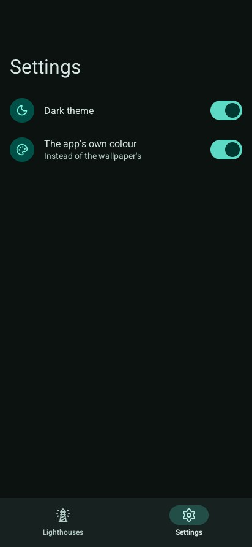

# Lesson 4: colours and settings

Android 12 and later colour apps from the wallpaper (Material You). In this lesson the app does
too, and a settings screen switches the dark theme and a colour of the app's own.

| Mission | Pieces | Time |
|---|---|---|
| A settings screen | `System`, `FromColour`, dark theme | 10 min |

#### The idea

On Android 12 and later, the phone **paints every app with its wallpaper's colours**, like a house where every room matches the hall. `material.System` asks for those colours; `FromColour` mixes a whole matching set from one colour of your own.

## Schemes

| Function | Gives |
|---|---|
| `material.System(dark)` | The wallpaper's colours on Android 12+, Material's baseline elsewhere. Call it every frame: they change with the wallpaper |
| `material.Baseline(dark)` | Material's own purple |
| `material.FromColour(colour, dark)` | A whole scheme from one colour, as Material's tools make it |
| `scheme.WithPrimary(…)` | A brand's colour in the primary roles only |
| `scheme.Theme(dark)` | Go UI's theme from the scheme, for Go UI's own controls |

`window.SystemPrefersDark()` says whether the phone (or the desktop, or the browser) is in its dark
theme. Lesson 1's `build` already picks the scheme from `program.dark` and `program.ownColour`.

## The settings screen

```go
// settings chooses the theme and the colours.
func (program *app) settings(look material.Look) {
	look.TopAppBar(material.TopBar{Title: "Settings", Large: true})
	look.ListItem("dark", material.Item{Icon: "moon", Headline: "Dark theme", Trailing: func() { look.Switch("dark", &program.dark) }})
	look.ListItem("colour", material.Item{Icon: "palette", Headline: "The app's own colour",
		Supporting: "Instead of the wallpaper's", Trailing: func() { look.Switch("colour", &program.ownColour) }})
}
```



To keep the choice between runs, use Go UI's `window.KeepPreference` in `Options.Hidden`, which is
called when the app leaves the screen; Android may end it afterwards without a word
([feeling at home on a phone](../4-guides/3-phone.md#the-phones-services)). More in [colours](../4-guides/2-colours.md).

#### Checkpoint

On *Settings*, *Dark theme* darkens the app, and *The app's own colour* turns it teal; on a phone with Material You, the wallpaper's colours come back when it is off.


## The whole program

```go
// Command lighthouses is the go-ui-android tutorial's program: a phone app with a list of
// lighthouses, a screen for each, a dialog before removing one, a note to undo it, and settings
// for the theme and the colours. The same code runs on the desktop, in a web page and on Android.
package main

import (
	"flag"
	"fmt"
	"log"
	"time"

	"github.com/akrck02/go-renderer/draw2d"
	ui "github.com/akrck02/go-ui"
	"github.com/akrck02/go-ui-android/material"
	"github.com/akrck02/go-ui/window"
)

// lighthouse is the program's own data.
type lighthouse struct {
	name, place string
	lit         bool
	rangeNM     float32
}

// app is everything the program remembers between frames.
type app struct {
	lighthouses []lighthouse
	place       int                 // the destination chosen in the navigation bar
	navigation  material.Navigation // the lighthouses' screens: "" is the list, a name its details
	removing    string              // the lighthouse the dialog asks about; "" when it is closed
	removed     *lighthouse         // the last one removed, for the note's Undo
	notes       material.Snackbar
	dark        bool
	ownColour   bool // a teal of the app's own instead of the wallpaper's colours
	added       int
}

// The destinations, in the navigation bar's order.
const (
	lighthousesPlace = iota
	settingsPlace
)

var places = []material.Destination{{Icon: "lighthouse", Label: "Lighthouses"}, {Icon: "settings", Label: "Settings"}}

func main() {
	options := window.Options{Title: "Lighthouses"}
	options.RegisterFlags(flag.CommandLine)
	flag.Parse()

	program := &app{
		lighthouses: []lighthouse{
			{name: "North Point", place: "On the northern cliffs", lit: true, rangeNM: 18},
			{name: "East Cape", place: "At the end of the cape", lit: true, rangeNM: 12},
			{name: "Harbour Mole", place: "At the harbour's mouth", rangeNM: 6},
			{name: "South Reef", place: "On a rock off the reef", lit: true, rangeNM: 15},
		},
		dark: options.Dark || window.SystemPrefersDark(),
	}
	material.UseRoboto() // Android's typeface, before the window reads the fonts
	if err := window.Run(options, program.build); err != nil {
		log.Fatal(err)
	}
}

// build describes the app for this frame.
func (program *app) build(context *ui.Context) {
	scheme := material.System(program.dark) // the wallpaper's colours on Android 12 and later
	if program.ownColour {
		scheme = material.FromColour(draw2d.Hex("#00796b"), program.dark)
	}
	context.Theme = scheme.Theme(program.dark)
	look := material.New(context, scheme)

	defer program.goBack(look) // last: what is over the screen answers the back first
	defer program.overlays(look)

	context.Box(ui.Layout{Direction: ui.Vertical, Width: ui.Grow(), Height: ui.Grow()}, func() {
		look.Body(false, func() {
			switch program.place {
			case lighthousesPlace:
				look.Screens("lighthouses", &program.navigation, func(key string) {
					if key == "" {
						program.list(look)
						return
					}
					program.details(look, key)
				})
			case settingsPlace:
				program.settings(look)
			}
		})
		look.NavigationBar(places, &program.place)
	})
}

// list shows every lighthouse; touching one opens its screen.
func (program *app) list(look material.Look) {
	context := look.Context
	look.TopAppBar(material.TopBar{Title: "Lighthouses", Large: true})
	context.ScrollArea("list", ui.Layout{Direction: ui.Vertical, Width: ui.Grow(), Height: ui.Grow()}, func() {
		for index := range program.lighthouses {
			light := &program.lighthouses[index]
			context.Push(light.name)
			icon := "lightbulb-off"
			if light.lit {
				icon = "lightbulb"
			}
			if look.ListItem("row", material.Item{Icon: icon, Headline: light.name, Supporting: light.place,
				Trailing: func() { look.Switch("lit", &light.lit) }}) {
				program.navigation.Go(light.name)
			}
			context.Pop()
		}
	})
	context.Box(ui.Layout{Width: ui.Grow(), Padding: ui.Pad(16), AlignX: ui.End}, func() {
		if look.ExtendedFloatingButton("plus", "New lighthouse") {
			program.added++
			name := fmt.Sprint("New lighthouse ", program.added)
			program.lighthouses = append(program.lighthouses, lighthouse{name: name, place: "Not placed yet", rangeNM: 10})
			program.navigation.Go(name)
		}
	})
}

// details is a lighthouse's own screen.
func (program *app) details(look material.Look, name string) {
	light := program.find(name)
	if light == nil { // removed while its screen was still sliding away
		return
	}
	if look.TopAppBar(material.TopBar{Title: light.name, Back: true, Actions: func() {
		if look.NamedIconButton("trash-2", "Remove") {
			program.removing = light.name
		}
	}}) {
		program.navigation.Back()
	}
	look.Context.Box(ui.Layout{Direction: ui.Vertical, Width: ui.Grow(), Padding: ui.Pad(16), Gap: 16}, func() {
		look.TextField("place", &light.place, material.Field{Label: "Where it stands", MaxLength: 60, Counter: true})
		look.Slider("range", &light.rangeNM, 1, 30, 1)
		look.Text(fmt.Sprintf("Seen from %.0f nautical miles", light.rangeNM), 14, draw2d.Regular, look.Scheme.OnSurfaceVariant)
		look.Context.Row(func() {
			look.Text("Lit", 16, draw2d.Regular, look.Scheme.OnSurface)
			look.Context.Spacer()
			look.Switch("lit", &light.lit)
		})
	})
}

// settings chooses the theme and the colours.
func (program *app) settings(look material.Look) {
	look.TopAppBar(material.TopBar{Title: "Settings", Large: true})
	look.ListItem("dark", material.Item{Icon: "moon", Headline: "Dark theme", Trailing: func() { look.Switch("dark", &program.dark) }})
	look.ListItem("colour", material.Item{Icon: "palette", Headline: "The app's own colour",
		Supporting: "Instead of the wallpaper's", Trailing: func() { look.Switch("colour", &program.ownColour) }})
}

// overlays draws what goes over the screens: the dialog that asks before removing, and the note.
func (program *app) overlays(look material.Look) {
	if program.removing != "" {
		answer := look.Dialog("remove", material.Dialog{Icon: "trash-2", Title: "Remove " + program.removing + "?",
			Text: "It leaves the list.", Confirm: "Remove", Dismiss: "Cancel"})
		if answer == material.Confirmed {
			program.remove(program.removing)
			program.navigation.Back()
			program.notes.Show(program.removed.name+" removed", "Undo", 5*time.Second)
		}
		if answer != material.Open {
			program.removing = ""
		}
	}
	program.notes.Above = material.NavigationBarHeight
	if look.Snackbar(&program.notes) && program.removed != nil {
		program.lighthouses = append(program.lighthouses, *program.removed) // Undo
		program.removed = nil
	}
}

// goBack answers the system's back: from a lighthouse to the list, from settings to the list;
// from the list nobody answers, and the app goes to the background.
func (program *app) goBack(look material.Look) {
	if program.place == lighthousesPlace && look.GoBack(&program.navigation) {
		return
	}
	if program.place != lighthousesPlace && look.Back() {
		program.place = lighthousesPlace
	}
}

func (program *app) find(name string) *lighthouse {
	for index := range program.lighthouses {
		if program.lighthouses[index].name == name {
			return &program.lighthouses[index]
		}
	}
	return nil
}

func (program *app) remove(name string) {
	for index, light := range program.lighthouses {
		if light.name == name {
			program.removed = &light
			program.lighthouses = append(program.lighthouses[:index], program.lighthouses[index+1:]...)
			return
		}
	}
}
```

---

[← Lesson 3](3-fields-dialogs-and-notes.md) · [Lesson 5: on a phone →](5-on-a-phone.md)
