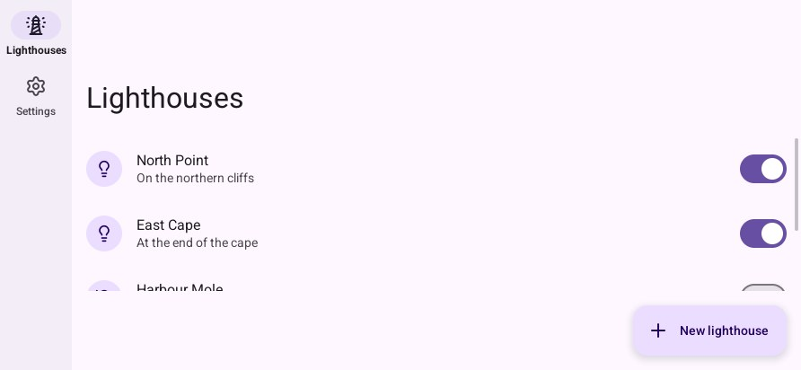
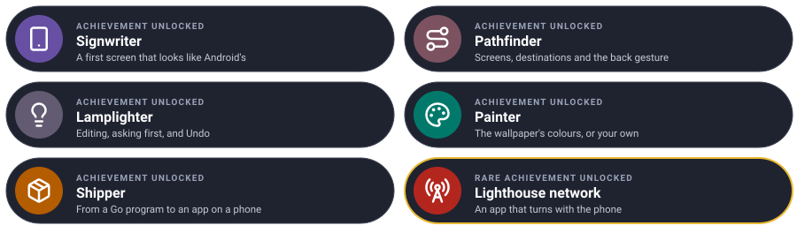

# Lesson 5: on a phone

The app runs on the desktop. In this lesson it becomes an Android package, installed on an
emulator or your own phone. You need no Java code, Gradle or Android Studio: **go-ui-apk** builds
the program with the NDK and packs it with the SDK's own tools.

| Mission | Pieces | Time |
|---|---|---|
| The app installed | the SDK, the NDK, go-ui-apk, `adb` | 30 min |

#### The idea

go-ui-apk is a **removal company**: it packs your program (built for the phone's processor with the NDK), Android's paperwork (the manifest, the icon) and a signature into one box, the `.apk`, which the phone unpacks and installs.

## 1. Install the Android tools

| You need | Why | How |
|---|---|---|
| The **Android SDK** command-line tools, with `platform-tools`, `build-tools` and a `platforms;android-…` | `aapt2`, `zipalign`, `apksigner`, `d8` and `adb` | [developer.android.com/studio#command-tools](https://developer.android.com/studio#command-tools), then `sdkmanager "platform-tools" "build-tools;35.0.0" "platforms;android-35"` |
| The **NDK** | Compiles the Go program (cgo) for the phone's processor | `sdkmanager "ndk;27.2.12479018"` |
| A **JDK** 17 or later | Compiles go-renderer's two small Java classes (the screen reader's, the keyboard's) | `javac` on the `PATH`, or `JAVA_HOME` |

```bash
export ANDROID_HOME=$HOME/android-sdk
export ANDROID_NDK_HOME=$ANDROID_HOME/ndk/27.2.12479018
```

## 2. Build the package

From the app's folder:

```bash
go run github.com/akrck02/go-ui-android/cmd/go-ui-apk -name Lighthouses -id io.example.lighthouses .
```

`-name` is the name under the icon, `-id` the application id (a reversed domain you own). It writes
`lighthouses.apk`, signed with the debug key (`~/.android/debug.keystore`, made when missing), for
arm64 phones. For the emulator on a PC add `-abi arm64,x86_64`.

## 3. Install it

On a phone: turn on *Developer options* and *USB debugging*, plug it in, then

```bash
adb install lighthouses.apk
```

Or on an emulator: make one with `avdmanager` (an `x86_64` system image), start it with
`emulator -avd <name>`, and `adb install` the same way.

What the program writes to standard error (a panic, `log.Print`) is in Android's log:

```bash
adb logcat -s Go
```

`window.LastCrash()` gives the program the report of its last crash, to show or send.

## 4. Make it look finished

| Flag | Gives |
|---|---|
| `-icon-foreground fg.png -icon-background '#00796b' -icon-monochrome mono.png` | An adaptive icon, cut to each launcher's shape, and a themed one |
| `-splash '#fef7ff' -splash-dark '#141218'` | The window's colour while the app starts |
| `-notifications` | The permission Android 13+ asks before `window.Notify` |
| `-version-code 2 -version 1.1` | The version |

## 5. A release

A store knows an app by its key: make one, keep it safe and out of the repository, and pass its
password through the environment, never the command line:

```bash
keytool -genkeypair -keystore lighthouses.keystore -alias lighthouses -keyalg RSA -validity 10000
GO_UI_APK_STORE_PASSWORD=… go run github.com/akrck02/go-ui-android/cmd/go-ui-apk \
    -name Lighthouses -id io.example.lighthouses \
    -release -keystore lighthouses.keystore -key-alias lighthouses -bundle .
```

`-bundle` writes the App Bundle (`.aab`) Google Play asks for. Every flag is in
[packaging](../4-guides/5-packaging.md).

#### Checkpoint

`adb install lighthouses.apk` says *Success*; the app is in the phone's launcher, opens on the list, and `adb logcat -s Go` shows what it prints.


## What you learnt

- go-ui-apk turns a Go `main` package into an `.apk` with the SDK, the NDK and a JDK.
- `adb install` and `adb logcat -s Go` for trying and debugging.
- Releases are signed with your own key; `-bundle` for Google Play.

## Final challenge · Lighthouse network

Turn the phone on its side: the app should move its destinations from the bar at the bottom to a **rail** down the left, as Android's own apps do on a wide screen.

> **Hint:** `look.Wide()` says the screen has more width than height to spare; `NavigationRail` takes the same destinations as the bar, and `look.Body(true, …)` keeps the content beside it.

Try it on your own first, then compare with the solution.



<details>
<summary>🔓 Show the solution</summary>

```go
// in build, instead of the vertical box
if look.Wide() {
	context.Box(ui.Layout{Width: ui.Grow(), Height: ui.Grow()}, func() {
		look.NavigationRail(places, &program.place)
		look.Body(true, func() { program.show(look) })
	})
	return
}
context.Box(ui.Layout{Direction: ui.Vertical, Width: ui.Grow(), Height: ui.Grow()}, func() {
	look.Body(false, func() { program.show(look) })
	look.NavigationBar(places, &program.place)
})
```

with `show` holding the `switch` over the places that was inside `Body`. On the desktop, `-width 892 -height 412` gives the window a phone's side.

</details>


## Well done



## Where next

- [The pieces](../4-guides/1-pieces.md): every Material piece, with pictures.
- [Feeling at home on a phone](../4-guides/3-phone.md): gestures, turning the phone, notifications, services.
- [Screen readers](../4-guides/4-screen-readers.md): how TalkBack reads the app.
- [The gallery](../4-guides/6-gallery.md): every piece in one program, to read its code.
- [The reference](../6-reference/0-reference.md).

---

[← Lesson 4](4-colours-and-settings.md) · [Tutorial](0-the-quest.md)
