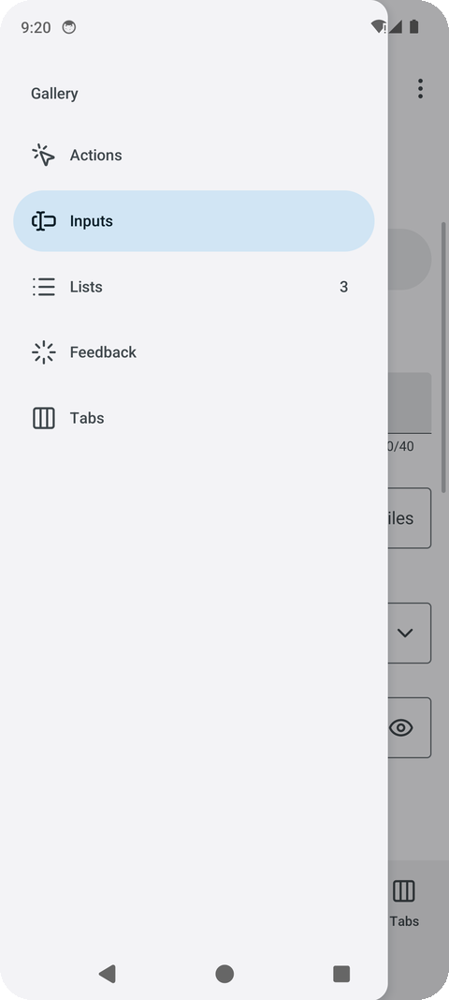
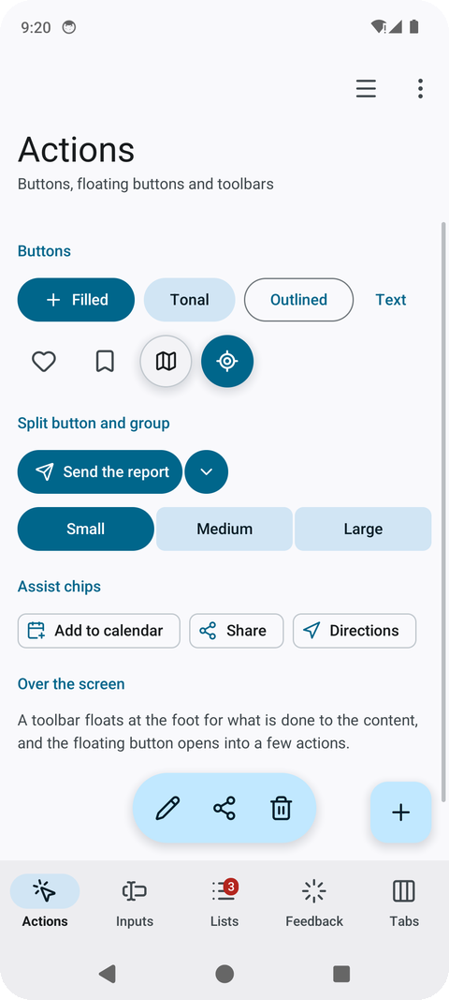
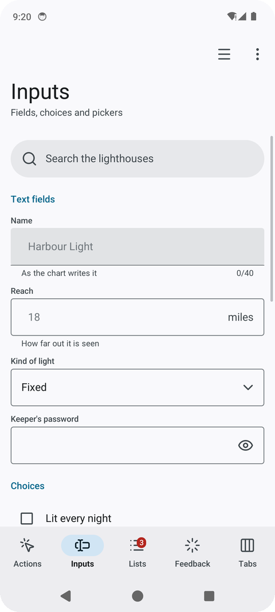
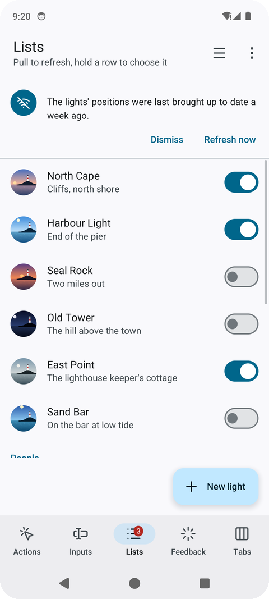
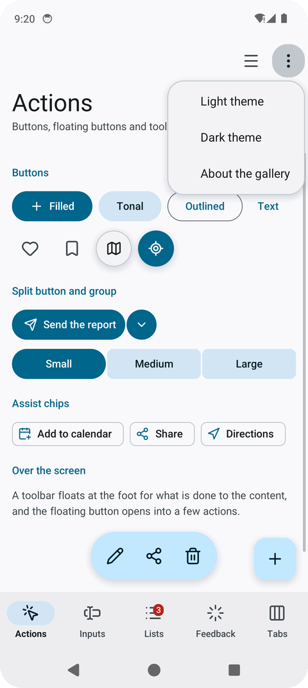
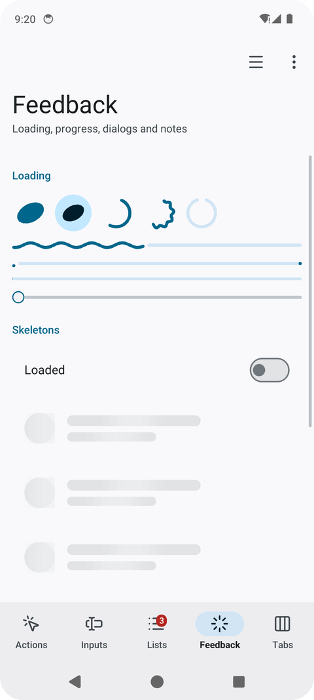
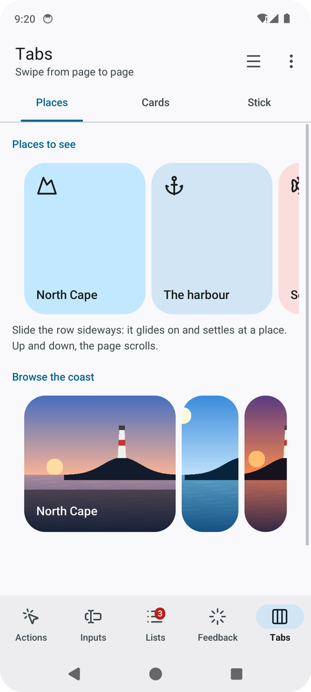

# 🧩 The pieces

Every piece, by Material's catalogue: navigation, actions, selection, inputs, containment,
overlays, pickers, progress and gestures. The package's files follow the same order (`doc.go` lists them).

## Navigation — `navigation.go`

<p align="center">
<picture>
  <source media="(prefers-color-scheme: dark)" srcset="../images/drawer-dark.png">
  
</picture>
</p>

| Piece | What it is |
|---|---|
| `TopAppBar(TopBar{…})` | The bar at the top, painted up under the status bar: a back arrow (a cross with `Close`, to leave a mode), a title and a subtitle, actions at its end; `Large` writes the title big under it, and with `Scrolled` (go-ui's `ScrollOffset` of the page under it) it shrinks into a small bar as the page goes up |
| `NavigationBar(destinations, &selected)` | Three to five destinations at the bottom, painted down under the gesture bar; `Destination.Badge` marks one with a count or a dot |
| `NavigationRail(destinations, &selected)` | The same down the left edge, on a wide screen (`Wide()`) |
| `NavigationDrawer(name, title, destinations, &selected)` | Every destination in a drawer sliding in from the left |
| `Tabs(name, labels, &selected)` | Primary tabs, the underline sliding to the one chosen |
| `TabPager(name, labels, &pager, page)` | Tabs over pages a finger swipes from side to side, the underline following them |
| `Body(besideRail, content)`, `Enter(key, content)` | A screen's content kept clear of the cutout and the gesture bar; a screen rising into place |
| `Navigation`, `Screens(name, &navigation, screen)`, `GoBack(&navigation)` | A stack of screens inside one place: `Go(key)` opens one sliding in from the right, `GoBack` from the system's back slides it away; the place's first screen is the key `""` |
| `Back()`, `StatusBarScrim()` | The system's back for the screen (see [Back and motion](3-phone.md#back-and-motion)); the strip under the status bar alone |

## Actions — `actions.go`

<p align="center">
<picture>
  <source media="(prefers-color-scheme: dark)" srcset="../images/actions-dark.png">
  
</picture>
</p>

| Piece | What it is |
|---|---|
| `FilledButton`, `TonalButton`, `OutlinedButton`, `TextButton` | Actions, from the most to the least important; an icon before the label when given |
| `IconButton(icon)`, `RoundButton(icon, size, primary)` | A round 48-pixel target with an icon; a round button floating over a map or a scene |
| `FloatingButton(icon)`, `ExtendedFloatingButton(icon, label)` | The floating action button, alone or with its action written |
| `FloatingMenu(name, &menu)` | The floating action button opening into a few actions stacked above it; `menu.Label` names it for a screen reader |
| `SplitButton(icon, label)` | A main action joined to a button opening its other choices; tells which half was touched |
| `ButtonGroup(name, labels, &selected)` | Expressive's connected buttons: the chosen one fills and rounds out |
| `FloatingToolbar(name, tools, above)` | A pill of actions floating over the content at the bottom: an icon each, its label read by a screen reader |

## Selection — `selection.go` and `chips.go`

| Piece | What it is |
|---|---|
| `Switch(name, &on)`, `Checkbox(label, &on)`, `RadioButton(label, chosen)` | On or off; ticked or not; one of a few |
| `SegmentedButtons(name, options, &selected)` | Two to five choices sharing a row, one chosen |
| `Slider(name, &value, minimum, maximum, step)` | A value between two ends, dragged |
| `FilterChip(label, selected)`, `AssistChip(icon, label)`, `InputChip(label)` | A choice on or off in a row; an action suggested beside the content; something entered, with a cross to take it out |
| `Tag(text, ink, tint)` | A label in a pill of its own colours: a state, a count |

## Inputs — `inputs.go`

<p align="center">
<picture>
  <source media="(prefers-color-scheme: dark)" srcset="../images/inputs-dark.png">
  
</picture>
</p>

| Piece | What it is |
|---|---|
| `TextField(name, &text, Field{…})` | Material's text field, outlined or `Filled`: a label, the box with a `Prefix` and a `Suffix`, a hint or an error under it and a `Counter`; `Secret` with `Reveal` for a password and its eye. The on-screen keyboard comes up while it is typed in, suggests words and underlines the one it is composing; a finger held on a word selects it, with handles to drag and a bar to cut, copy and paste (`Look.Words` in the person's language) |
| `Dropdown(name, label, choices, &dropdown)` | Material's exposed dropdown: a box showing the choice, opening the choices under it |
| `SearchView(name, placeholder, &search, content)` | A search pill that opens over the whole screen, ready to type in, with what the program finds under it |
| `SearchBar(name, &text, placeholder)` | A pill to search in, with a button to empty it |

## Containment — `containment.go`

<p align="center">
<picture>
  <source media="(prefers-color-scheme: dark)" srcset="../images/lists-dark.png">
  
</picture>
</p>

| Piece | What it is |
|---|---|
| `ListItem(name, Item{…})` | A list row: an icon in a round avatar (or a photo, `Picture`), a headline, a supporting line, something at its end; `Selected` tints it and puts a tick in the avatar's place |
| `ExpandableItem(name, item, &open, more)` | A row that unfolds to show more under it and folds back, its chevron turning |
| `Card`, `ElevatedCard`, `OutlinedCard` | Containers for one subject: filled, raised over a scene, drawn by their border |
| `Avatar(name, icon, tint, size)`, `PictureAvatar(picture, size)` | A person's initials or a thing's icon in a circle; a photo in one |
| `Banner(icon, text, actions…)` | A message across the top of the content that stays until acted on |
| `SectionTitle`, `Heading`, `Divider` | A small heading over a list's rows; one for content with its own margins; a line between groups |
| `Text`, `Paragraph` (`look.go`) | One line; text that breaks into lines at the width it has |

## Overlays — `overlays.go`

<p align="center">
<picture>
  <source media="(prefers-color-scheme: dark)" srcset="../images/menu-dark.png">
  
</picture>
</p>

| Piece | What it is |
|---|---|
| `Dialog(name, Dialog{…})` | A question over the dimmed screen: an icon, a title, a text, more content, one or two actions. Returns `Open`, `Confirmed` or `Dismissed` |
| `BottomSheet(name, content)` | Choices or a short form in a sheet rising from the bottom |
| `StandardSheet(name, &sheet, peek, content)` | A sheet over the screen that does not dim it (a map's places): it rests low or expanded, and a finger drags it by its handle |
| `SideSheet(name, title, content)` | Filters or details in a sheet sliding in from the end, with a title and a cross |
| `Snackbar(&snackbar)` | A short note at the bottom for a few seconds, with an action (`snackbar.Show(text, action, duration)`) |
| `Menu(icon, choices)` | A button that opens a list of choices; returns the one chosen |

## Pickers — `pickers.go`

| Piece | What it is |
|---|---|
| `DatePicker(name, &picker, &date)` | A day chosen a month at a time, in a dialog; `DateNames` for another language |
| `TimePicker(name, &picker, &date)` | A time on Material's dial: the hours 1 to 12 round it and 13 to 00 inside, then the minutes; touched or dragged round |

## Progress — `progress.go`

<p align="center">
<picture>
  <source media="(prefers-color-scheme: dark)" srcset="../images/feedback-dark.png">
  
</picture>
</p>

| Piece | What it is |
|---|---|
| `LoadingIndicator(size)`, `ContainedLoadingIndicator(size)` | Expressive's indicator for a short wait: a filled shape turning and morphing from one form to the next, alone or on a round container |
| `CircularProgress(fraction, size, wavy)` | A ring filling as work gets done, or an arc chasing round (`Indeterminate`); wavy as Expressive draws it |
| `WavyProgress(fraction)`, `LinearProgress(fraction)` | A line filling with a travelling wave, a track and a stop dot; the plain line |
| `VideoPlayer(name, video, height)` | A film (go-ui's `window.Video`) in a rounded box, a round play button over it while paused, a line of how far it has played; touching it plays or pauses |
| `Skeleton(width, height, radius)` | A quiet block with a light crossing it, standing in for content still coming |

go-renderer draws rounded rectangles, shadows, text and icons; the indicators' shapes are made of
rectangles in a box the program paints itself (go-ui's `Context.Paint`): a shape is filled row by
row and edged with small dots, a wave or an arc is a line of dots. An indicator asks for frames
while it is on screen, and a screen without one sleeps: five of them at once take about a third of
a core on a OnePlus 7 Pro, and nothing once the screen is left.

## Gestures — `gestures.go`, and the stick — `stick.go`

<p align="center">
<picture>
  <source media="(prefers-color-scheme: dark)" srcset="../images/tabs-dark.png">
  
</picture>
</p>

| Piece | What it is |
|---|---|
| `LongPressed()` | Whether the piece drawn just before was held: the phone buzzes, and a list starts choosing rows |
| `PullToRefresh(name, refreshing, layout, rows)` | A list that refreshes when pulled down past its top and let go; the indicator stays while `refreshing` |
| `SwipeToDismiss(name, row)` | A row a finger slides away, a bin in the gap it leaves |
| `Carousel(name, &carousel, count, itemWidth, item)`, `CarouselItem` | A row of tiles slid sideways, gliding on and settling at a tile |
| `CarouselPicture(picture, height, title)` | A carousel item made of a photo, its title on a dark veil at its foot |
| `MultiBrowseCarousel(name, &carousel, count, largeWidth, height, item)` | Material's multi-browse carousel: large tiles, then a medium and a small one; tiles shrink towards the edges and grow as they come in |
| `Stick(name, &stick, size)` | An on-screen stick for walking or driving with a thumb |

## Pictures

Photos are go-renderer's `draw2d.Image`: decode one once (`draw2d.DecodeImage` reads a PNG, JPEG
or GIF the program embeds) and keep it. `context.Image(picture, layout, radius)` draws it filling a
box, cropped evenly where their shapes differ; the pieces take one where a photo belongs:
`Item.Picture` in a list row's avatar, `PictureAvatar`, `CarouselPicture` in a carousel. The
gallery paints its own pictures of a coast at different times of day, so it ships no photos.

```go
//go:embed north-cape.jpg
var northCapeFile []byte

northCape, err := draw2d.DecodeImage(bytes.NewReader(northCapeFile))
…
look.ListItem("north", material.Item{Picture: northCape, Headline: "North Cape"})
```

## Films

`window.OpenVideo(film)` opens a film (the bytes of an MP4 or WebM, often embedded) and
`look.VideoPlayer` shows it: on Android the phone's own decoders read it, in a browser the browser
does, without sound for now; on the desktop films do not play yet (`window.ErrVideoUnsupported`).
The gallery's film, six seconds of a made-up coast at dusk, plays in a card on the tabs screen; on
a OnePlus 7 Pro it takes about two fifths of a core while it plays.

```go
//go:embed harbour.mp4
var harbour []byte

video, err := window.OpenVideo(harbour)
video.Loop = true
…
look.VideoPlayer("harbour", video, 180)
```

---

[← All the documentation](../1-overview.md)
