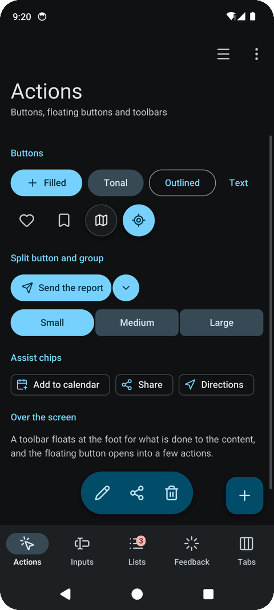

# 🎨 Colours

<table>
<tr><th>Light</th><th>Dark</th></tr>
<tr>
<td></td>
<td></td>
</tr>
</table>

A `Scheme` holds Material's colour roles: the primary colour and the text on it, its container, the
surface and the raised containers over it, the outlines, the error colours and the inverse ones.

- **`material.System(dark)`** takes the colours the phone made from its **wallpaper** (Android 12
  and later, Material You), as the system's own applications do, and Material's baseline elsewhere
  (an older phone, the desktop, a browser). Call it in every frame: the colours change with the
  wallpaper. The roles are taken from Android's palettes as its own dynamic colours take them: the
  primary from the first accent palette, the containers from the second, the surfaces from the
  neutral ones; the error colours stay Material's.
- **`material.Baseline(dark)`** is Material's own purple scheme, always the same.
- **`material.FromColour(colour, dark)`** makes a whole scheme from one colour (a brand's, a
  place's), as Material's own tools do: palettes of its hue at every tone, as Android makes them
  from a wallpaper, then the roles from them. Each tone is the colour's CIELAB lightness, as in
  Material, so text keeps its contrast whatever the colour; the hues are worked in OKLCH, where
  they stay even. `PalettesFromColour` gives the palettes themselves.
- **`scheme.WithPrimary(…)`** puts a brand's colour in the primary roles only.
- **`scheme.Theme(dark)`** gives go-ui's own controls (its slider, text fields, menus) the scheme and
  sizes for fingers; set it as the context's theme before the pieces.

---

[← All the documentation](../1-overview.md)
