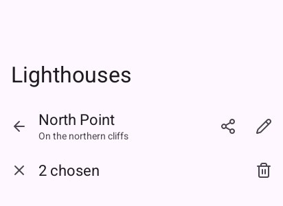
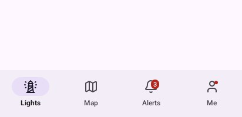
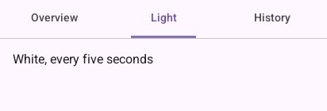

# Navigation

## `TopAppBar`

The bar at the top of a screen, painted up under the status bar. It returns `true` when its back
arrow is touched.

```go
look.TopAppBar(material.TopBar{Title: "Lighthouses", Large: true}) // a screen's first level
look.TopAppBar(material.TopBar{Title: "North Point", Subtitle: "On the northern cliffs", Back: true,
	Actions: func() {
		look.NamedIconButton("share-2", "Share")
		look.NamedIconButton("pencil", "Edit")
	}})
look.TopAppBar(material.TopBar{Title: "2 chosen", Back: true, Close: true, // a mode, left with the cross
	Actions: func() { look.NamedIconButton("trash-2", "Remove") }})
```



| Case | Use |
|---|---|
| A destination's first screen | `Large: true`: the title big under the bar. With `Scrolled: look.Context.ScrollOffset("list")` it shrinks into a small bar as the list goes up |
| A screen gone to from another | `Back: true`, and `navigation.Back()` when it returns `true` |
| A mode, such as rows chosen | `Back: true, Close: true`: a cross, and the count as the title |
| Over a map or a 3D scene | `OverScene: true`: see-through |

Actions go in `Actions`, usually `NamedIconButton`s; more than two or three go in a `Menu`.

## `NavigationBar` and `NavigationRail`

Three to five destinations at the bottom, painted under the gesture bar. It edits the index of the
destination chosen; show the screen with a `switch`. A `Badge` marks a destination with a count
or, with `"•"`, a dot.

```go
places := []material.Destination{
	{Icon: "lighthouse", Label: "Lights"},
	{Icon: "map", Label: "Map"},
	{Icon: "bell", Label: "Alerts", Badge: "3"}, // a count
	{Icon: "user", Label: "Me", Badge: "•"},     // a dot
}
look.Context.Box(ui.Layout{Width: ui.Grow(), Height: ui.Grow()}, nil) // the screen above it
look.NavigationBar(places, &place)
```



On a phone on its side (`look.Wide()`), draw `NavigationRail(places, &place)` down the left
instead, with `look.Body(true, …)`. Lift floating things over the bar by
`material.NavigationBarHeight`.

## `NavigationDrawer`

Every destination in a drawer sliding in from the left: for more than five destinations, or ones
seldom used. It returns `true` when it closes (a destination touched, the scrim, the back
gesture). Open it from a menu icon in the top bar.

```go
look.TopAppBar(material.TopBar{Title: "Lighthouses"})
places := []material.Destination{{Icon: "lighthouse", Label: "Lights"}, {Icon: "map", Label: "Map"},
	{Icon: "bell", Label: "Alerts"}, {Icon: "settings", Label: "Settings"}}
if open && look.NavigationDrawer("drawer", "Coast guard", places, &place) {
	open = false // a destination touched, the scrim touched, or the back gesture
}
```


## `Tabs`

Primary tabs under the top bar, the underline sliding to the one chosen, for views of **one**
thing (a lighthouse's overview, light and history). For tabs whose pages a finger swipes, use
[`TabPager`](9-gestures.md#tabpager).

```go
look.Tabs("view", []string{"Overview", "Light", "History"}, &tab)
padded(look, func() {
	switch tab {
	case 0:
		look.Text("North Point, on the northern cliffs", 16, 0, look.Scheme.OnSurface)
	case 1:
		look.Text("White, every five seconds", 16, 0, look.Scheme.OnSurface)
	case 2:
		look.Text("Lit for the first time long ago", 16, 0, look.Scheme.OnSurface)
	}
})
```



## `Screens`, `Navigation`, `GoBack`

A stack of screens inside one destination: a list, then one row's screen, then a form. The program
keeps a `material.Navigation`; `Go(name)` opens a screen sliding in from the right, `Back()` returns,
and `look.Screens` draws the one on top by its name (`""` is the first).

```go
look.Screens("lighthouses", &navigation, func(key string) {
	if key == "" {
		drawList(look) // its rows call navigation.Go(light.name)
		return
	}
	drawLighthouse(look, key)
})

// last in the frame, after dialogs and sheets:
if look.GoBack(&navigation) {
	return // the back gesture went back a screen
}
if look.Back() {
	… // anything else the back should do; nobody answering sends the app to the background
}
```

See [the tutorial's lesson 2](../3-the-quest/2-screens-and-back.md) for a whole app.

---

[← Components](0-components.md) · [Actions →](2-actions.md)
