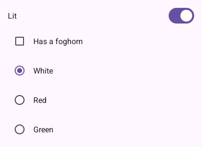
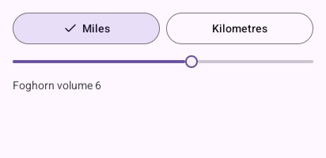
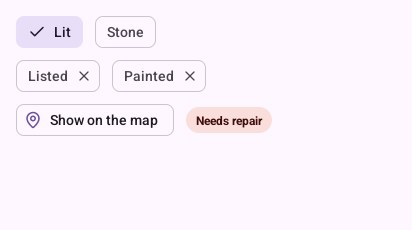

# Selection

## `Switch`, `Checkbox`, `RadioButton`

| Piece | When |
|---|---|
| `Switch(name, &on)` | A setting that takes effect at once; at the end of a row or a list item |
| `Checkbox(label, &on)` | One of several facts in a form, or rows to choose |
| `RadioButton(label, chosen)` | One of a few choices, all in sight; it returns `true` when touched, and the program chooses |

```go
padded(look, func() {
	look.Context.Row(func() {
		look.Text("Lit", 16, draw2d.Regular, look.Scheme.OnSurface)
		look.Context.Spacer()
		look.Switch("lit", &lit) // takes effect at once
	})
	look.Checkbox("Has a foghorn", &foghorn) // part of a form
	for index, name := range []string{"White", "Red", "Green"} {
		if look.RadioButton(name, colour == index) { // one of a few, all in sight
			colour = index
		}
	}
})
```



TalkBack reads a switch as on or off, a checkbox as ticked, a radio button as chosen.

## `SegmentedButtons` and `Slider`

Two to five short choices sharing a row, one chosen (units, a view); and a value between two ends,
in steps. Write the value beside a slider when it matters.

```go
padded(look, func() {
	look.SegmentedButtons("units", []string{"Miles", "Kilometres"}, &units)
	look.Slider("volume", &volume, 0, 10, 1)
	look.Text(fmt.Sprintf("Foghorn volume %.0f", volume), 14, draw2d.Regular, look.Scheme.OnSurfaceVariant)
})
```



## Chips and tags

| Piece | When |
|---|---|
| `FilterChip(label, selected)` | A filter on or off over a list; returns `true` when touched |
| `InputChip(label)` | Something entered (a tag, a person), with a cross: returns `touched, removed` |
| `AssistChip(icon, label)` | An action suggested beside the content |
| `Tag(text, ink, tint)` | A label in its own colours: a state, a count. It is not touched |

```go
padded(look, func() {
	look.Context.Row(func() { // filters over a list
		if look.FilterChip("Lit", lit) {
			lit = !lit
		}
		if look.FilterChip("Stone", stone) {
			stone = !stone
		}
	})
	look.Context.Row(func() { // what was entered, removable
		for index := 0; index < len(tags); index++ {
			if _, removed := look.InputChip(tags[index]); removed {
				tags = append(tags[:index], tags[index+1:]...)
				index--
			}
		}
	})
	look.Context.Row(func() { // suggested actions
		look.AssistChip("map-pin", "Show on the map")
		look.Tag("Needs repair", look.Scheme.OnErrorContainer, look.Scheme.ErrorContainer)
	})
})
```



---

[← Actions](2-actions.md) · [Inputs →](4-inputs.md)
