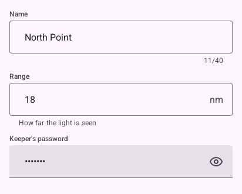
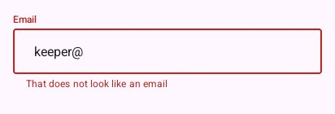
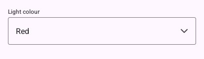
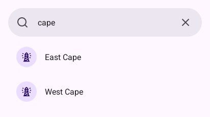

# Inputs

## `TextField`

Material's text field, outlined or `Filled`, editing your string. `material.Field` says what goes
round it:

```go
padded(look, func() {
	look.TextField("name", &name, material.Field{Label: "Name", MaxLength: 40, Counter: true})
	look.TextField("range", &rangeText, material.Field{Label: "Range", Suffix: "nm", Supporting: "How far the light is seen"})
	look.TextField("password", &password, material.Field{Label: "Keeper's password", Secret: true, Reveal: &reveal, Filled: true})
})
```



| Field | Means |
|---|---|
| `Label`, `Placeholder` | Above the box; quiet in it while empty |
| `Supporting`, `Error` | A hint under it; an error instead, the box turned red |
| `MaxLength`, `Counter` | The most characters; a count under it |
| `Prefix`, `Suffix` | A currency, a unit, written in the box |
| `Secret`, `Reveal` | A password; with `Reveal`, an eye shows it while `*Reveal` is true |
| `Filled` | Material's filled field, for a form on a plain screen |

On a phone the keyboard comes up while it is typed in, suggests words and underlines the one it
composes; a finger held on a word selects it, with handles and a bar to cut, copy and paste (in
`look.Words`, the person's language).

### Saying what is wrong

```go
padded(look, func() {
	field := material.Field{Label: "Email", Placeholder: "keeper@example.com"}
	if email != "" && !validEmail(email) {
		field.Error = "That does not look like an email"
	}
	look.TextField("email", &email, field)
})
```



Show the error once something was typed, not on an empty form.

## `Dropdown`

Material's exposed dropdown: a box showing the choice that opens the choices under it. The program
keeps a `material.Dropdown`, whose `Selected` is the choice.

```go
padded(look, func() {
	colours := []string{"White", "Red", "Green", "Amber"}
	if look.Dropdown("colour", "Light colour", colours, &dropdown) {
		// dropdown.Selected changed
	}
})
```



## `SearchBar` and `SearchView`

`SearchBar` is a pill to search in, with a cross to empty it, above results the program filters.
`SearchView(name, placeholder, &search, content)` is a pill that opens over the whole screen,
ready to type in, with what the program finds under it; `search.Query` is what is typed and
`search.Active` whether it is open.

```go
padded(look, func() {
	look.SearchBar("search", &text, "Search lighthouses")
	for _, name := range []string{"East Cape", "West Cape"} { // what matches text
		look.ListItem(name, material.Item{Icon: "lighthouse", Headline: name})
	}
})
```



---

[← Selection](3-selection.md) · [Containment →](5-containment.md)
