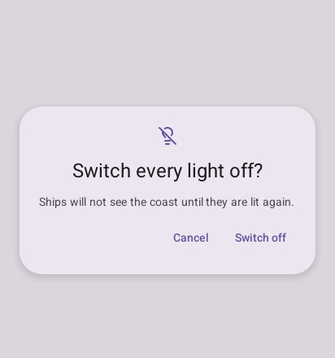
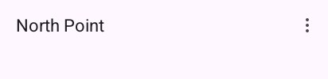

# Overlays

Draw overlays **after** the screen in the frame (a `defer` at the start of the frame does it), so
they are on top and answer the back gesture first.

## `Dialog`

A question over the dimmed screen. Show it while your program asks; it returns `material.Open`
while waiting, then `Confirmed` or `Dismissed` (the other action, a touch outside, the back
gesture) once.

```go
if asking {
	answer := look.Dialog("switch off", material.Dialog{Icon: "lightbulb-off", Title: "Switch every light off?",
		Text: "Ships will not see the coast until they are lit again.", Confirm: "Switch off", Dismiss: "Cancel"})
	if answer == material.Confirmed {
		// switch them off
	}
	asking = answer == material.Open // Confirmed or Dismissed: it closes
}
```



`Content` adds more under the text (a field, choices).

## `BottomSheet`, `StandardSheet`, `SideSheet`

| Piece | When |
|---|---|
| `BottomSheet(name, content)` | Choices or a short form rising from the bottom, the screen dimmed. Returns `true` when dragged down or dismissed |
| `StandardSheet(name, &sheet, peek, content)` | A sheet over the screen that does not dim it (a map's places): it rests low or expanded, dragged by its handle |
| `SideSheet(name, title, content)` | Filters or details sliding in from the end, with a title and a cross |

```go
if open && look.BottomSheet("actions", func() {
	look.ListItem("share", material.Item{Icon: "share-2", Headline: "Share the chart"})
	look.ListItem("copy", material.Item{Icon: "copy", Headline: "Copy the position"})
	if look.ListItem("close", material.Item{Icon: "x", Headline: "Close"}) {
		open = false
	}
}) {
	open = false // dragged down, the scrim touched, or the back gesture
}
```

## `Snackbar`

A short note at the bottom for a few seconds, with an action that undoes or follows what was just
done. Keep one `material.Snackbar`, call `Show(text, action, duration)` when something happens,
and draw it in **every** frame; it returns `true` when its action is touched. Set `Above` to
`material.NavigationBarHeight` over a navigation bar.

```go
if first { // when something happens: here, at once
	notes.Show("North Point removed", "Undo", 5*time.Second)
}
look.Context.Box(ui.Layout{Width: ui.Grow(), Height: ui.Grow()}, nil)
if look.Snackbar(&notes) { // every frame
	// put it back
}
```

## `Menu`

A button (three dots, usually) that opens a list of choices under it; it returns the one chosen, or
-1. TalkBack reads the button as "More options".

```go
look.TopAppBar(material.TopBar{Title: "North Point", Actions: func() {
	switch look.Menu("ellipsis-vertical", []string{"Rename", "Duplicate", "Remove"}) {
	case 0: // rename
	case 1: // duplicate
	case 2: // remove
	}
}})
```



---

[← Containment](5-containment.md) · [Pickers →](7-pickers.md)
