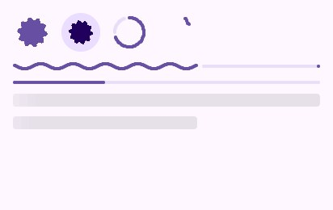

# Progress

```go
padded(look, func() {
	look.Context.Row(func() {
		look.LoadingIndicator(48)          // a short wait, nothing to measure
		look.ContainedLoadingIndicator(48) // the same on a round container
		look.CircularProgress(0.7, 48, false)
		look.CircularProgress(material.Indeterminate, 48, true)
	})
	look.WavyProgress(0.6) // work being done, with a fraction
	look.LinearProgress(0.3)
	look.Skeleton(ui.Grow(), ui.Fixed(16), 4) // content still coming
	look.Skeleton(ui.Percent(0.6), ui.Fixed(16), 4)
})
```



| Piece | When |
|---|---|
| `LoadingIndicator(size)`, `ContainedLoadingIndicator(size)` | A short wait with nothing to measure: Expressive's shape that turns and morphs |
| `CircularProgress(fraction, size, wavy)` | Work with a fraction, in a small place; `material.Indeterminate` for an arc chasing round |
| `WavyProgress(fraction)`, `LinearProgress(fraction)` | Work with a fraction across the screen |
| `Skeleton(width, height, radius)` | Blocks standing in for content still coming, with a light crossing them |

Indicators ask for frames only while on screen; a screen without one sleeps.

`VideoPlayer(name, video, height)` plays a film (`window.OpenVideo`) in a rounded box, touched to
play or pause: see [the pieces](../4-guides/1-pieces.md#films).

---

[← Pickers](7-pickers.md) · [Gestures →](9-gestures.md)
