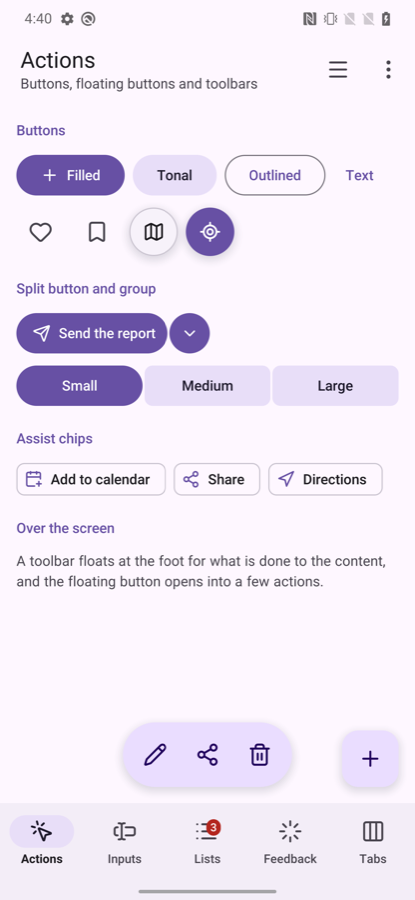
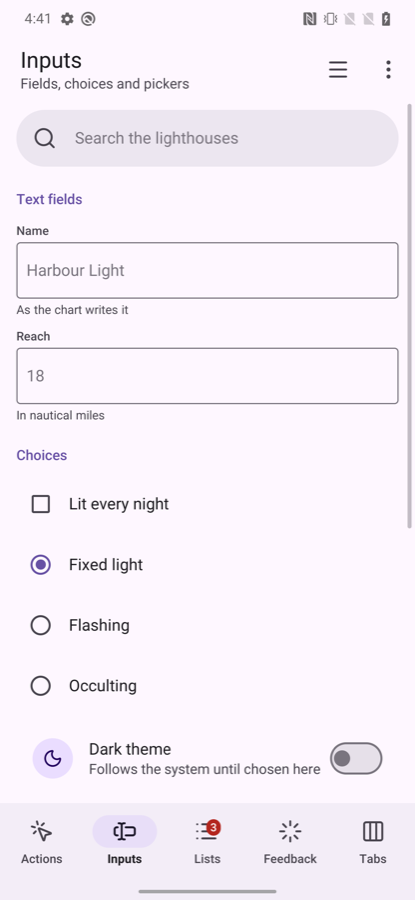
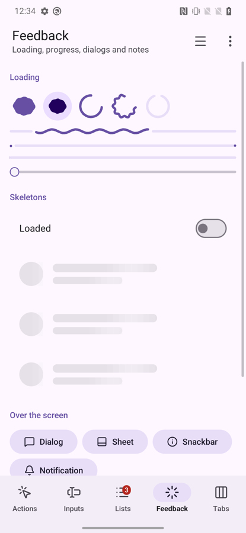
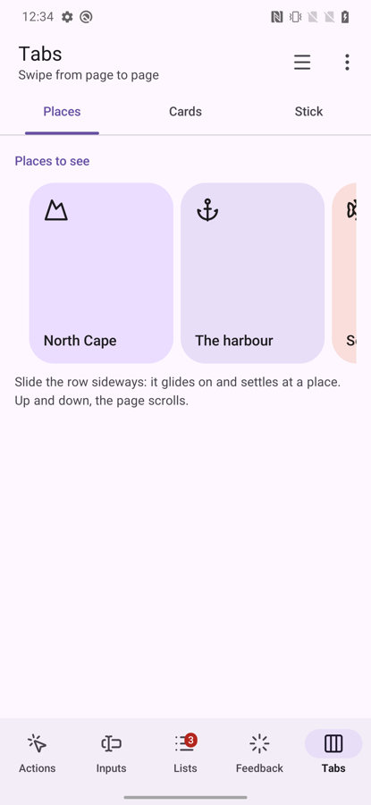

# go-ui-android

Two things for a [go-ui](https://github.com/akrck02/go-ui) program that should feel at home on a
phone: **`material`**, pieces drawn the way Android's own applications are (Material Design 3, with
Material 3 Expressive's newer pieces), and **`go-ui-apk`**, a tool that turns the program into an
Android package.

Neither needs Java, Gradle or Android Studio. The program stays an ordinary Go `main` package that
calls go-ui's `window.Run`: on the desktop it opens a window, built for WebAssembly it draws in a web
page, and on Android it is a shared library that Android's own `NativeActivity` loads (go-renderer's
`android` package).

- [Using the pieces](#using-the-pieces)
- [The pieces, by Material's catalogue](#the-pieces-by-materials-catalogue)
- [Pictures](#pictures)
- [Gestures](#gestures)
- [Back and motion](#back-and-motion)
- [Colours](#colours)
- [Turning the phone](#turning-the-phone)
- [Notifications](#notifications)
- [Packaging: go-ui-apk](#packaging-go-ui-apk)
- [The gallery](#the-gallery)

## Using the pieces

A program makes a `material.Look` in every frame, from the go-ui context and a colour scheme, and
calls its pieces. Pieces that can be touched return `true` in the frame they are touched, as go-ui's
own controls do; the ones that keep something between frames (a pager, a carousel, a snackbar, a
picker) take a small struct of the program's.

```go
dark := window.SystemPrefersDark()
scheme := material.System(dark) // the wallpaper's colours on Android 12 and later
context.Theme = scheme.Theme(dark)
look := material.New(context, scheme)

look.TopAppBar(material.TopBar{Title: "Lighthouses"})
if look.FilledButton("plus", "Add one") { … }
look.NavigationBar(places, &screen)
```

Sizes are Material's: targets of at least 48 pixels, bars 64 and 80 pixels tall, 16-pixel text. A
finger has no hover, so pieces change only while pressed. Each piece takes the name go-ui tells it
apart by (its label, its icon or a name given); rows that repeat get a scope each with
`context.Push`, as in go-ui. `material.UseRoboto()`, before the window opens, draws every text in
Roboto, Android's typeface.

## The pieces, by Material's catalogue

The package's files follow the same order (`doc.go` lists them).

### Navigation — `navigation.go`

| Piece | What it is |
|---|---|
| `TopAppBar(TopBar{…})` | The bar at the top, painted up under the status bar: a back arrow (a cross with `Close`, to leave a mode), a title and a subtitle, actions at its end; `Large` writes the title big under it, and with `Scrolled` (go-ui's `ScrollOffset` of the page under it) it shrinks into a small bar as the page goes up |
| `NavigationBar(destinations, &selected)` | Three to five destinations at the bottom, painted down under the gesture bar; `Destination.Badge` marks one with a count or a dot |
| `NavigationRail(destinations, &selected)` | The same down the left edge, on a wide screen (`Wide()`) |
| `NavigationDrawer(name, title, destinations, &selected)` | Every destination in a drawer sliding in from the left |
| `Tabs(name, labels, &selected)` | Primary tabs, the underline sliding to the one chosen |
| `TabPager(name, labels, &pager, page)` | Tabs over pages a finger swipes from side to side, the underline following them |
| `Body(besideRail, content)`, `Enter(key, content)` | A screen's content kept clear of the cutout and the gesture bar; a screen rising into place |
| `Back()`, `StatusBarScrim()` | The system's back for the screen (see [Back and motion](#back-and-motion)); the strip under the status bar alone |

### Actions — `actions.go`

| Piece | What it is |
|---|---|
| `FilledButton`, `TonalButton`, `OutlinedButton`, `TextButton` | Actions, from the most to the least important; an icon before the label when given |
| `IconButton(icon)`, `RoundButton(icon, size, primary)` | A round 48-pixel target with an icon; a round button floating over a map or a scene |
| `FloatingButton(icon)`, `ExtendedFloatingButton(icon, label)` | The floating action button, alone or with its action written |
| `FloatingMenu(name, &menu)` | The floating action button opening into a few actions stacked above it |
| `SplitButton(icon, label)` | A main action joined to a button opening its other choices; tells which half was touched |
| `ButtonGroup(name, labels, &selected)` | Expressive's connected buttons: the chosen one fills and rounds out |
| `FloatingToolbar(name, icons, above)` | A pill of actions floating over the content at the bottom |

### Selection — `selection.go` and `chips.go`

| Piece | What it is |
|---|---|
| `Switch(name, &on)`, `Checkbox(label, &on)`, `RadioButton(label, chosen)` | On or off; ticked or not; one of a few |
| `SegmentedButtons(name, options, &selected)` | Two to five choices sharing a row, one chosen |
| `Slider(name, &value, minimum, maximum, step)` | A value between two ends, dragged |
| `FilterChip(label, selected)`, `AssistChip(icon, label)`, `InputChip(label)` | A choice on or off in a row; an action suggested beside the content; something entered, with a cross to take it out |
| `Tag(text, ink, tint)` | A label in a pill of its own colours: a state, a count |

### Inputs — `inputs.go`

| Piece | What it is |
|---|---|
| `TextField(name, &text, Field{…})` | Material's outlined field: a label, the box, a hint or an error under it. The on-screen keyboard comes up while it is typed in |
| `SearchBar(name, &text, placeholder)` | A pill to search in, with a button to empty it |

### Containment — `containment.go`

| Piece | What it is |
|---|---|
| `ListItem(name, Item{…})` | A list row: an icon in a round avatar (or a photo, `Picture`), a headline, a supporting line, something at its end; `Selected` tints it and puts a tick in the avatar's place |
| `ExpandableItem(name, item, &open, more)` | A row that unfolds to show more under it and folds back, its chevron turning |
| `Card`, `ElevatedCard`, `OutlinedCard` | Containers for one subject: filled, raised over a scene, drawn by their border |
| `Avatar(name, icon, tint, size)`, `PictureAvatar(picture, size)` | A person's initials or a thing's icon in a circle; a photo in one |
| `Banner(icon, text, actions…)` | A message across the top of the content that stays until acted on |
| `SectionTitle`, `Heading`, `Divider` | A small heading over a list's rows; one for content with its own margins; a line between groups |
| `Text`, `Paragraph` (`look.go`) | One line; text that breaks into lines at the width it has |

### Overlays — `overlays.go`

| Piece | What it is |
|---|---|
| `Dialog(name, Dialog{…})` | A question over the dimmed screen: an icon, a title, a text, more content, one or two actions. Returns `Open`, `Confirmed` or `Dismissed` |
| `BottomSheet(name, content)` | Choices or a short form in a sheet rising from the bottom |
| `SideSheet(name, title, content)` | Filters or details in a sheet sliding in from the end, with a title and a cross |
| `Snackbar(&snackbar)` | A short note at the bottom for a few seconds, with an action (`snackbar.Show(text, action, duration)`) |
| `Menu(icon, choices)` | A button that opens a list of choices; returns the one chosen |

### Pickers — `pickers.go`

| Piece | What it is |
|---|---|
| `DatePicker(name, &picker, &date)` | A day chosen a month at a time, in a dialog; `DateNames` for another language |
| `TimePicker(name, &picker, &date)` | A time on Material's dial: the hours 1 to 12 round it and 13 to 00 inside, then the minutes; touched or dragged round |

### Progress — `progress.go`

| Piece | What it is |
|---|---|
| `LoadingIndicator(size)`, `ContainedLoadingIndicator(size)` | Expressive's indicator for a short wait: a filled shape turning and morphing from one form to the next, alone or on a round container |
| `CircularProgress(fraction, size, wavy)` | A ring filling as work gets done, or an arc chasing round (`Indeterminate`); wavy as Expressive draws it |
| `WavyProgress(fraction)`, `LinearProgress(fraction)` | A line filling with a travelling wave, a track and a stop dot; the plain line |
| `VideoPlayer(name, video, height)` | A film (go-ui's `window.Video`) in a rounded box, a round play button over it while paused, a line of how far it has played; touching it plays or pauses |
| `Skeleton(width, height, radius)` | A quiet block with a light crossing it, standing in for content still coming |

go-renderer draws rounded rectangles, shadows, text and icons; the indicators' shapes are made of
rectangles in a box the program paints itself (go-ui's `Context.Paint`): a shape is filled row by
row and edged with small dots, a wave or an arc is a line of dots. An indicator asks for frames
while it is on screen, and a screen without one sleeps: five of them at once take about a third of
a core on a OnePlus 7 Pro, and nothing once the screen is left.

### Gestures — `gestures.go`, and the stick — `stick.go`

| Piece | What it is |
|---|---|
| `LongPressed()` | Whether the piece drawn just before was held: the phone buzzes, and a list starts choosing rows |
| `PullToRefresh(name, refreshing, layout, rows)` | A list that refreshes when pulled down past its top and let go; the indicator stays while `refreshing` |
| `SwipeToDismiss(name, row)` | A row a finger slides away, a bin in the gap it leaves |
| `Carousel(name, &carousel, count, itemWidth, item)`, `CarouselItem` | A row of tiles slid sideways, gliding on and settling at a tile |
| `CarouselPicture(picture, height, title)` | A carousel item made of a photo, its title on a dark veil at its foot |
| `MultiBrowseCarousel(name, &carousel, count, largeWidth, height, item)` | Material's multi-browse carousel: large tiles, then a medium and a small one; tiles shrink towards the edges and grow as they come in |
| `Stick(name, &stick, size)` | An on-screen stick for walking or driving with a thumb |

## Pictures

Photos are go-renderer's `draw2d.Image`: decode one once (`draw2d.DecodeImage` reads a PNG, JPEG
or GIF the program embeds) and keep it. `context.Image(picture, layout, radius)` draws it filling a
box, cropped evenly where their shapes differ; the pieces take one where a photo belongs:
`Item.Picture` in a list row's avatar, `PictureAvatar`, `CarouselPicture` in a carousel. The
gallery paints its own pictures of a coast at different times of day, so it ships no photos.

```go
//go:embed north-cape.jpg
var northCapeFile []byte

northCape, err := draw2d.DecodeImage(bytes.NewReader(northCapeFile))
…
look.ListItem("north", material.Item{Picture: northCape, Headline: "North Cape"})
```

### Films

`window.OpenVideo(film)` opens a film (the bytes of an MP4 or WebM, often embedded) and
`look.VideoPlayer` shows it: on Android the phone's own decoders read it, in a browser the browser
does, without sound for now; on the desktop films do not play yet (`window.ErrVideoUnsupported`).
The gallery's film, six seconds of a made-up coast at dusk, plays in a card on the tabs screen; on
a OnePlus 7 Pro it takes about two fifths of a core while it plays.

```go
//go:embed harbour.mp4
var harbour []byte

video, err := window.OpenVideo(harbour)
video.Loop = true
…
look.VideoPlayer("harbour", video, 180)
```

## Gestures

go-ui follows the one finger on a touch screen from where it comes down. Once it has moved a few
pixels, the way it went first decides who takes it: the innermost list for up and down, the
innermost of the sideways pieces (a carousel inside swiping pages) for sideways. The control it came
down on is then not touched, and a finger that hardly moves stays a touch. So the pieces sit inside
each other freely: the gallery has a carousel inside a list inside swiping pages, and rows swiped
away inside a list pulled to refresh.

- **Long press.** A finger held still on a piece for half a second (go-ui's `LongPressed`; with a
  mouse, its right button) long-presses it, and lifting it then is no touch. `look.LongPressed()`
  after a piece tells, and gives the phone's short buzz, as Android's own applications do. A list
  starts choosing with it: the row held is chosen (`Item.Selected`), touches choose more, and the
  top bar says how many, with a cross to stop (`TopBar.Close`) and actions for what is chosen.

  ```go
  touched := look.ListItem("row", material.Item{Headline: light.name, Selected: light.chosen})
  switch {
  case look.LongPressed():
  	light.chosen = true
  case touched && choosing:
  	light.chosen = !light.chosen
  }
  ```
- **Pull to refresh.** The indicator follows the pull (go-ui's `ScrollPull`); let go past 64 pixels,
  `PullToRefresh` returns true, and the program refreshes, keeping `refreshing` set until done.
- **Swiping pages.** A page let go past a third of the way, or flicked, turns to the next; the tab
  underline moves with the pages, between two tabs while a page is half way.
- **Rows swiped away.** Past two fifths of their width, or flicked, they go; short of that they slide
  back.
- **Carousels.** Let go, they glide on with the finger's speed and settle at a tile's edge.
- **The stick.** The finger that comes down on it holds it; `Forward` and `Sideways` go from -1 to 1.
  Other fingers stay free, so a program can turn a view with them (`context.Touches()`, leaving out
  `stick.Touching(touch)`). It can sit anywhere, in a `Push` scope, a list or swiping pages: the
  finger steering it is its own, so the pages and the list stay still under it.

## Back and motion

A phone's back gesture reaches the program. Dialogs, sheets, the drawer and the floating menu answer
it first and close; then `look.Back()` tells the screen, which stops choosing rows or goes back (to
the first destination, to the list a detail came from). A back nobody answers sends the program to
the background, as Android's own applications do at their first screen. Ask for it after drawing what goes over the
screen, so that gets it first:

```go
defer func() {
	if screen != firstScreen && look.Back() {
		screen = firstScreen
	}
}()
```

Pieces move as Material's do, and only while they move does the window draw: the switch's handle
slides and grows, the navigation bar's pill widens under the chosen icon, the tabs' underline slides,
dialogs rise in as the screen darkens, sheets and the drawer slide in, the snackbar slides up, the
floating menu's actions rise one after another, and `look.Enter(key, …)` lets a screen rise into
place when it is first shown.

They leave with motion too, though a program simply stops drawing them: a dialog answered fades
out, a sheet slides back down, the drawer slides back off the side, the snackbar fades when its time
is up, a side sheet slides back off its side, a floating menu's actions sink and fade as it
closes, and a row's more folds back under it. go-ui keeps what such a layer
painted last (`LayerOptions.Leave`) and lets that picture go; nothing in it can be touched on its
way out.

## Colours

A `Scheme` holds Material's colour roles: the primary colour and the text on it, its container, the
surface and the raised containers over it, the outlines, the error colours and the inverse ones.

- **`material.System(dark)`** takes the colours the phone made from its **wallpaper** (Android 12
  and later, Material You), as the system's own applications do, and Material's baseline elsewhere
  (an older phone, the desktop, a browser). Call it in every frame: the colours change with the
  wallpaper. The roles are taken from Android's palettes as its own dynamic colours take them: the
  primary from the first accent palette, the containers from the second, the surfaces from the
  neutral ones; the error colours stay Material's.
- **`material.Baseline(dark)`** is Material's own purple scheme, always the same.
- **`material.FromColour(colour, dark)`** makes a whole scheme from one colour (a brand's, a
  place's), as Material's own tools do: palettes of its hue at every tone, as Android makes them
  from a wallpaper, then the roles from them. Each tone is the colour's CIELAB lightness, as in
  Material, so text keeps its contrast whatever the colour; the hues are worked in OKLCH, where
  they stay even. `PalettesFromColour` gives the palettes themselves.
- **`scheme.WithPrimary(…)`** puts a brand's colour in the primary roles only.
- **`scheme.Theme(dark)`** gives go-ui's own controls (its slider, text fields, menus) the scheme and
  sizes for fingers; set it as the context's theme before the pieces.

## Turning the phone

A phone on its side has more width than height to spare, and its camera's cutout at a side. Material
moves the destinations from a bar at the bottom to a rail down the left:

```go
if look.Wide() {
	context.Box(ui.Layout{Width: ui.Grow(), Height: ui.Grow()}, func() {
		look.NavigationRail(places, &screen)
		look.Body(true, func() { drawScreen(look) })
	})
	return
}
context.Box(ui.Layout{Direction: ui.Vertical, Width: ui.Grow(), Height: ui.Grow()}, func() {
	look.Body(false, func() { drawScreen(look) })
	look.NavigationBar(places, &screen)
})
```

`Body` keeps the content clear of the cutout; go-ui-apk's window theme paints beside it
(`shortEdges`), so no black strip is left there.

## Notifications

A program's notifications go through go-ui's window: `window.Notify(id, title, text)` shows one in
the phone's shade, even while the program is in the background, and touching it opens the program.
Android 13 and later show them only once the person allows it: check `window.NotificationsAllowed()`
and ask with `window.AskForNotifications()` when they do something that needs them. Build the
package with `go-ui-apk -notifications`, which names the permission. In a browser they are the
page's notifications; on the desktop they are not shown yet.

## Packaging: go-ui-apk

```bash
export ANDROID_HOME=…/android-sdk      # with build-tools and a platform
export ANDROID_NDK_HOME=…/ndk/<version>
go run github.com/akrck02/go-ui-android/cmd/go-ui-apk -name Gallery -id io.example.gallery ./cmd/gallery
```

It builds the program as a shared library for each processor asked for (arm64 phones by default) with the NDK's compiler (aligned to 16 KB
pages, which Android 15 and later phones need), writes the manifest and a window theme that lets the
program paint under the system's bars (light or dark with the phone) and beside a camera's cutout,
and packs, aligns and signs the package with the SDK's own `aapt2`, `zipalign` and `apksigner`. The
window shrinks while the on-screen keyboard is up. It signs with the debug key in
`~/.android/debug.keystore`, making it when missing, for phones and the emulator; a release is
signed with the program's own key (below).

| Flag | What it sets |
|---|---|
| `-name` | The name under the icon (required) |
| `-id` | The application id, like `io.example.app` (required) |
| `-o` | The package to write; the program's folder name `.apk` by default |
| `-version-code`, `-version` | The version's number and the version people read |
| `-min-sdk`, `-target-sdk` | The oldest Android it runs on (26, Android 8, at least) and the one it is made for |
| `-icon` | A square PNG for the launcher |
| `-debuggable` | Lets `adb` read its folder and debug it; on by default |
| `-notifications` | Names the permission Android 13 and later ask before showing notifications |
| `-abi` | The processors to carry a library for: `arm64` (phones, the default), `x86_64` (the emulator on a PC), `arm` (old 32-bit phones); `-abi arm64,x86_64` for several |
| `-release`, `-keystore`, `-key-alias` | Signs with the program's own key instead of the debug key, and leaves the package not debuggable: for a store |

**A release** is signed with a key of the program's own, which a store knows it by from then on:
keep the key store safe and out of the repository. The store's password is read from
`GO_UI_APK_STORE_PASSWORD` (and the key's, when different, from `GO_UI_APK_KEY_PASSWORD`), never
from the command line, which other users of the computer can see:

```bash
keytool -genkeypair -keystore lighthouses.keystore -alias lighthouses -keyalg RSA -validity 10000
GO_UI_APK_STORE_PASSWORD=… go run ./cmd/go-ui-apk -name Lighthouses -id io.example.lighthouses \
    -release -keystore lighthouses.keystore -key-alias lighthouses -version-code 2 -version 1.1 ./cmd/lighthouses
```

What the program writes to its standard error (a panic, `log.Fatal`) is in Android's log:
`adb logcat -s Go`.

## The gallery

`cmd/gallery` has a screen for each part of the catalogue, one file each (`-screen 0` to `4` opens on
one, for captures):

| Actions | Inputs | Lists | Feedback | Tabs |
|---|---|---|---|---|
|  |  |  |  |  |

It was tried on a Pixel 6 Pro (Android 16, the wallpaper's colours, dark), the Android 16 emulator
(light, turned all the way round) and a OnePlus 7 Pro (Android 10, Material's baseline): every
screen, the gestures, the keyboard, a notification, going to the background and back. Its test
(`cmd/gallery`) touches every destination from every other with a finger; the material package's
tests drive each piece with a fake pointer and fake fingers, with no display.

## Not yet

- App bundles (`.aab`), which Google Play asks for new applications: they need Google's `bundletool`.

## Building

go-ui-android builds against `go-ui` and `go-renderer` checked out beside it (`replace` in `go.mod`),
until they publish versions with touches, insets, the wallpaper's palettes and the Android window.
