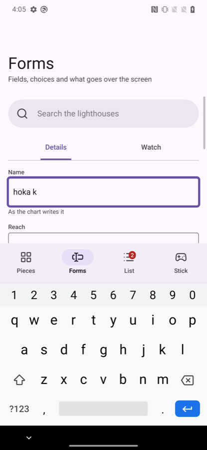
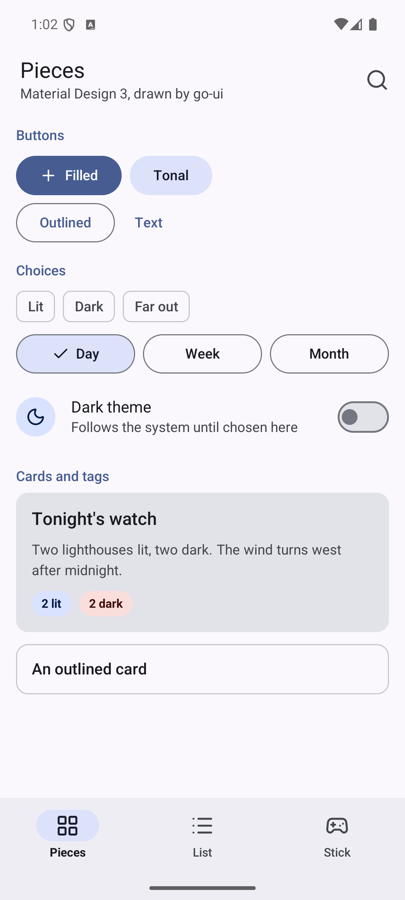
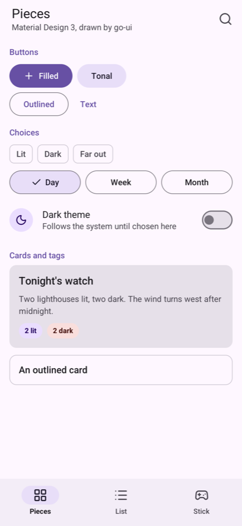

# go-ui-android

Two things for a [go-ui](https://github.com/akrck02/go-ui) program that should feel at home on a
phone: **`material`**, pieces drawn the way Android's own applications are, and **`go-ui-apk`**, a
tool that turns the program into an Android package.

Neither needs Java, Gradle or Android Studio. The program stays an ordinary Go `main` package that
calls go-ui's `window.Run`: on the desktop it opens a window, built for WebAssembly it draws in a web
page, and on Android it is a shared library that Android's own `NativeActivity` loads (go-renderer's
`android` package).

## The pieces

A program makes a `material.Look` in every frame, from the go-ui context and a colour scheme, and
calls its pieces. Pieces that can be touched return `true` in the frame they are touched, as go-ui's
own controls do.

| Piece | What it is |
|---|---|
| `TopAppBar(TopBar{…})` | The bar at the top, painted up under the status bar: a back arrow, a title and a subtitle, actions at its end. Returns true when the arrow is touched |
| `NavigationBar(destinations, &selected)` | The bar at the bottom, painted down under the gesture bar, three to five destinations; the selected one has its icon on a pill |
| `NavigationRail(destinations, &selected)` | The navigation bar's form on a wide screen: the destinations down the left edge. `Wide()` tells when |
| `Body(besideRail, content)` | A screen's content between the bars, kept clear of a cutout at the sides and, beside a rail, of the gesture bar |
| `StatusBarScrim()` | The strip under the status bar alone, for a screen whose top is a map or a scene |
| `FilledButton`, `TonalButton`, `OutlinedButton`, `TextButton` | Actions, from the most to the least important; an icon before the label when given |
| `IconButton(icon)` | A round 48-pixel target with an icon, in the bars and at the end of rows |
| `FloatingButton(icon)`, `RoundButton(icon, size, primary)` | The floating action button; a round button floating over a map or a scene |
| `Switch(name, &on)` | Material's switch |
| `FilterChip(label, selected)` | A choice that is on or off, among others in a row |
| `SegmentedButtons(name, options, &selected)` | Two to five choices sharing a row, one chosen |
| `Tag(text, ink, tint)` | A label in a pill of its own colours: a state, a count |
| `ListItem(name, Item{…})` | A list row: an icon in a round avatar, a headline, a supporting line, something at its end |
| `Card`, `ElevatedCard`, `OutlinedCard` | Containers for one subject: filled, raised over a scene, drawn by their border |
| `SectionTitle`, `Divider` | A small heading over a group of rows; a line between groups |
| `Text`, `Paragraph` | One line; text that breaks into lines at the width it has |
| `Stick(name, &stick, size)` | An on-screen stick for walking or driving with a thumb |
| `TextField(name, &text, Field{…})` | Material's outlined field: a label, the box, a hint or an error under it. The on-screen keyboard comes up while it is typed in |
| `SearchBar(name, &text, placeholder)` | A pill to search in, with a button to empty it |
| `Checkbox(label, &on)`, `RadioButton(label, chosen)` | A tick box; one of a few choices |
| `Tabs(name, labels, &selected)` | Primary tabs under a top bar, the chosen one underlined |
| `Menu(icon, choices)` | A button that opens a list of choices; returns the one chosen |
| `LinearProgress(fraction)` | A bar that fills; a negative fraction for work of unknown length |
| `ExtendedFloatingButton(icon, label)` | The floating action button with its action written |
| `Dialog(name, Dialog{…})` | A question over the dimmed screen: an icon, a title, a text, more content, one or two actions. Returns `Open`, `Confirmed` or `Dismissed` |
| `BottomSheet(name, content)` | Choices or a short form in a sheet rising from the bottom |
| `Snackbar(&snackbar)` | A short note at the bottom for a few seconds, with an action (`snackbar.Show(text, action, duration)`) |

`TopBar{Large: true}` writes the title big under the bar, and `Destination.Badge` marks a
destination's icon with a count or a dot.



### Notifications

A program's notifications go through go-ui's window: `window.Notify(id, title, text)` shows one in
the phone's shade, even while the program is in the background, and touching it opens the program.
Android 13 and later show them only once the person allows it: check `window.NotificationsAllowed()`
and ask with `window.AskForNotifications()` when they do something that needs them. Build the
package with `go-ui-apk -notifications`, which names the permission. In a browser they are the
page's notifications; on the desktop they are not shown yet. The gallery's Forms screen sends one.

Sizes are Material's: targets of at least 48 pixels, bars 64 and 80 pixels tall, 16-pixel text.
A finger has no hover, so pieces change only while pressed. Each piece takes the name go-ui tells it
apart by (its label, its icon or a name given); rows that repeat get a scope each with
`context.Push`, as in go-ui.

### Turning the phone

A phone on its side has more width than height to spare, and its camera's cutout at a side. Material
moves the destinations from a bar at the bottom to a rail down the left:

```go
if look.Wide() {
	context.Box(ui.Layout{Width: ui.Grow(), Height: ui.Grow()}, func() {
		look.NavigationRail(places, &screen)
		look.Body(true, func() { drawScreen(look) })
	})
	return
}
context.Box(ui.Layout{Direction: ui.Vertical, Width: ui.Grow(), Height: ui.Grow()}, func() {
	look.Body(false, func() { drawScreen(look) })
	look.NavigationBar(places, &screen)
})
```

`Body` keeps the content clear of the cutout; go-ui-apk's window theme paints beside it
(`shortEdges`), so no black strip is left there. The gallery does this, and was turned all the way
round on the Android 16 emulator.

### Colours

A `Scheme` holds Material's colour roles: the primary colour and the text on it, its container, the
surface and the raised containers over it, the outlines, the error colours.

- **`material.System(dark)`** takes the colours the phone made from its **wallpaper** (Android 12
  and later, Material You), as the system's own applications do, and Material's baseline elsewhere
  (an older phone, the desktop, a browser). Call it in every frame: the colours change with the
  wallpaper. The roles are taken from Android's palettes as its own dynamic colours take them: the
  primary from the first accent palette, the containers from the second, the surfaces from the
  neutral ones; the error colours stay Material's.
- **`material.Baseline(dark)`** is Material's own purple scheme, always the same.
- **`scheme.WithPrimary(…)`** puts a brand's colour in the primary roles.
- **`scheme.Theme(dark)`** gives go-ui's own controls (its slider, text fields, menus) the scheme and
  sizes for fingers; set it as the context's theme before the pieces.

`material.UseRoboto()`, before the window opens, draws every text in Roboto, Android's typeface.

| The wallpaper's colours (Android 16 emulator) | Material's baseline (a desktop window; the same on Android 10) |
|---|---|
|  |  |

### The stick

`Stick` is for a program that moves something with a thumb: a 3D walk, a game. The finger that comes
down on the stick holds it, and where that finger is from the stick's middle gives `Forward` and
`Sideways`, from -1 to 1; letting go brings it back to the middle. Other fingers stay free, so a
program can turn a view with them: it reads `context.Touches()` and leaves out the stick's finger
(`stick.Touching(touch)`). While held, the stick asks for frames, so what it drives keeps moving
under a finger that stays still.

The stick finds where it was laid out by its name, so it is drawn outside `Push` scopes and scroll
areas.

## Packaging: go-ui-apk

```bash
export ANDROID_HOME=…/android-sdk      # with build-tools and a platform
export ANDROID_NDK_HOME=…/ndk/<version>
go run github.com/akrck02/go-ui-android/cmd/go-ui-apk -name Gallery -id io.example.gallery ./cmd/gallery
```

It builds the program as a shared library for arm64 phones with the NDK's compiler (aligned to 16 KB
pages, which Android 15 and later phones need), writes the manifest and a window theme that lets the
program paint under the system's bars (light or dark with the phone), and packs, aligns and signs
the package with the SDK's own `aapt2`, `zipalign` and `apksigner`. It signs with the debug key in
`~/.android/debug.keystore`, making it when missing: for phones and the emulator, not for a store.

| Flag | What it sets |
|---|---|
| `-name` | The name under the icon (required) |
| `-id` | The application id, like `io.example.app` (required) |
| `-o` | The package to write; the program's folder name `.apk` by default |
| `-version-code`, `-version` | The version's number and the version people read |
| `-min-sdk`, `-target-sdk` | The oldest Android it runs on (26, Android 8, at least) and the one it is made for |
| `-icon` | A square PNG for the launcher |
| `-debuggable` | Lets `adb` read its folder and debug it; on by default |
| `-notifications` | Names the permission Android 13 and later ask before showing notifications |

What the program writes to its standard error (a panic, `log.Fatal`) is in Android's log:
`adb logcat -s Go`.

## Tried on

The gallery on a Pixel 6 Pro (Android 16, the wallpaper's colours, dark), the Android 16 emulator
(the wallpaper's colours, light, turned all the way round) and a OnePlus 7 Pro (Android 10, Material's baseline): every piece,
the theme following the phone, the stick, going to the background and back. The tests
(`go test ./...`) drive the pieces with a fake pointer and fake fingers, and check the schemes and
the tool's manifest, with no display.

## Not yet

- Date and time pickers, sliders in Material's own look (go-ui's slider takes the theme), chips with
  a close button, carousels.
- The back gesture inside the program, and long presses.
- Packages for x86_64 emulators and for stores (a release key, an app bundle).
- A tool that turns a brand's single colour into a whole scheme, as Material's does.

## Building

go-ui-android builds against `go-ui` and `go-renderer` checked out beside it (`replace` in `go.mod`),
until they publish versions with touches, insets, the wallpaper's palettes and the Android window.
