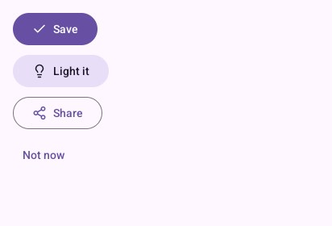
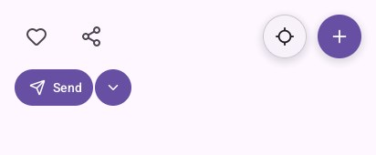
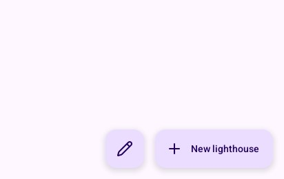
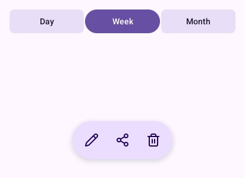

# Actions

## `FilledButton`, `TonalButton`, `OutlinedButton`, `TextButton`

Four levels of emphasis, from the screen's main action to the least important. Each takes an icon
(or `""`) and a label, and returns `true` when touched.

```go
padded(look, func() {
	look.FilledButton("check", "Save")        // the main action of the screen
	look.TonalButton("lightbulb", "Light it") // important, but not the main one
	look.OutlinedButton("share-2", "Share")   // secondary
	look.TextButton("", "Not now")            // the least important: in dialogs, beside others
})
```



One filled button per screen at most. Dialogs use text buttons (the `Dialog` piece does it for you).

## `NamedIconButton`, `IconButton`, `RoundButton`, `SplitButton`

A round 48-pixel target with an icon. `NamedIconButton(icon, name)` gives TalkBack a name for it:
use it always, unless the icon's meaning is in words beside it (`IconButton(icon)`).
`RoundButton(icon, size, primary)` floats over a map or a scene. `SplitButton` joins a main
action to an arrow opening its other choices, and tells which half was touched.

```go
padded(look, func() {
	look.Context.Row(func() {
		look.NamedIconButton("heart", "Favourite") // a name for TalkBack
		look.NamedIconButton("share-2", "Share")
		look.Context.Spacer()
		look.RoundButton("locate", 48, false) // over a map: centre on me
		look.RoundButton("plus", 48, true)
	})
	look.Context.Row(func() {
		if action, more := look.SplitButton("send", "Send"); action {
			// send now
		} else if more {
			// open the other ways of sending
		}
	})
})
```



## `FloatingButton` and `ExtendedFloatingButton`

The floating action button: the screen's one main action (write, add), at the bottom end, over
the content. The extended one says its action in words: use it while the screen is at rest, as on
a list's first screen.

```go
look.Context.Box(ui.Layout{Width: ui.Grow(), Height: ui.Grow()}, nil) // the list
look.Context.Box(ui.Layout{Width: ui.Grow(), Padding: ui.Pad(16), Gap: 16, AlignX: ui.End}, func() {
	look.FloatingButton("pencil")                         // the screen's one main action
	look.ExtendedFloatingButton("plus", "New lighthouse") // the same, with its words
})
```



`FloatingMenu(name, &menu)` opens into a few related actions stacked above it, its icon turning
into a cross; it returns the action touched, or -1. `menu.Label` names it for TalkBack.

## `ButtonGroup` and `FloatingToolbar`

`ButtonGroup` (Material 3 Expressive's connected buttons) chooses one of a few, the chosen one
filled and rounded out. `FloatingToolbar` is a pill of actions floating at the bottom, for what is
done to the content on show; it returns the index of the tool touched, or -1, and TalkBack reads
each tool's label.

```go
padded(look, func() {
	look.ButtonGroup("view", []string{"Day", "Week", "Month"}, &view)
})
look.Context.Box(ui.Layout{Width: ui.Grow(), Height: ui.Grow()}, nil)
switch look.FloatingToolbar("tools", []material.Destination{
	{Icon: "pencil", Label: "Edit"}, {Icon: "share-2", Label: "Share"}, {Icon: "trash-2", Label: "Remove"},
}, 16) {
case 0: // edit
case 1: // share
case 2: // remove
}
```



---

[← Navigation](navigation.md) · [Selection →](selection.md)
