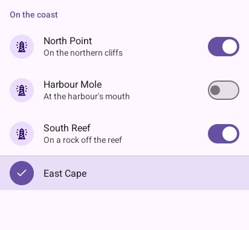
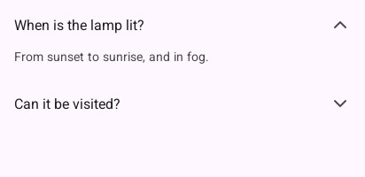
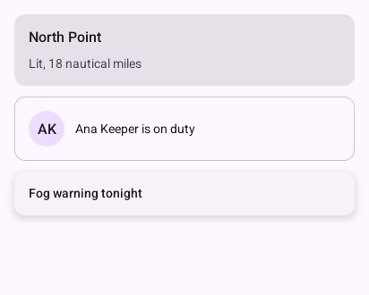
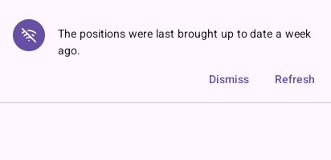

# Containment

## `ListItem`

A list row: an icon in a round avatar (or a photo, `Picture`), a headline, a supporting line, and
`Trailing` for what goes at its end (a switch, an icon button, a tag). It returns `true` when
touched. `Selected` tints it and puts a tick in the avatar's place, for rows chosen with a long
press.

```go
look.SectionTitle("On the coast")
names := []string{"North Point", "Harbour Mole", "South Reef"}
places := []string{"On the northern cliffs", "At the harbour's mouth", "On a rock off the reef"}
for index, name := range names {
	look.Context.Push(name) // rows repeat: a scope each
	if look.ListItem("row", material.Item{Icon: "lighthouse", Headline: name, Supporting: places[index],
		Trailing: func() { look.Switch("lit", &lit[index]) }}) {
		// open its screen
	}
	look.Context.Pop()
}
look.Divider()
look.ListItem("chosen", material.Item{Icon: "lighthouse", Headline: "East Cape", Selected: true}) // chosen with a long press
```



Touching the switch at its end does not touch the row. For photos, decode a `draw2d.Image` once and
pass it as `Picture`.

## `ExpandableItem`

A row that unfolds to show more under it, its chevron turning: questions and answers, details.

```go
questions := []string{"When is the lamp lit?", "Can it be visited?"}
answers := []string{"From sunset to sunrise, and in fog.", "On summer weekends."}
for index, question := range questions {
	look.ExpandableItem(fmt.Sprint("question ", index), material.Item{Headline: question}, &open[index], func() {
		look.Paragraph(answers[index], 14, draw2d.Regular, look.Scheme.OnSurfaceVariant)
	})
}
```



## `Card`, `OutlinedCard`, `ElevatedCard`, `Avatar`

Containers for one subject. Filled on a plain screen, outlined beside other cards, elevated over a
map or a scene. `Avatar(name, icon, tint, size)` draws a person's initials (or an icon) in a
circle; `PictureAvatar(picture, size)` a photo.

```go
padded(look, func() {
	look.Card(func() { // filled: on a plain screen
		look.Text("North Point", 16, draw2d.Medium, look.Scheme.OnSurface)
		look.Text("Lit, 18 nautical miles", 14, draw2d.Regular, look.Scheme.OnSurfaceVariant)
	})
	look.OutlinedCard(func() { // drawn by its border: beside other cards
		look.Context.Row(func() {
			look.Avatar("Ana Keeper", "", draw2d.Color{}, 40) // initials in a circle
			look.Text("Ana Keeper is on duty", 14, draw2d.Regular, look.Scheme.OnSurface)
		})
	})
	look.ElevatedCard(func() { // raised: over a map or a scene
		look.Text("Fog warning tonight", 14, draw2d.Medium, look.Scheme.OnSurface)
	})
})
```



## `Banner`

A message across the top that stays until acted on: no connection, an update. It returns the index
of the action touched, or -1.

```go
if shown {
	switch look.Banner("wifi-off", "The positions were last brought up to date a week ago.", "Dismiss", "Refresh") {
	case 0:
		shown = false
	case 1:
		shown = false // and refresh
	}
}
look.Context.Box(ui.Layout{Width: ui.Grow(), Height: ui.Grow()}, nil)
```



For a note that goes by itself, use a [`Snackbar`](overlays.md#snackbar).

## `SectionTitle`, `Heading`, `Divider`, `Text`, `Paragraph`

A small heading over a list's rows; a heading for content with its own margins; a line between
groups; one line of text; and text that breaks into lines at the width it has (`Paragraph`, the
only piece that wraps).

---

[← Inputs](inputs.md) · [Overlays →](overlays.md)
