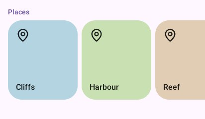
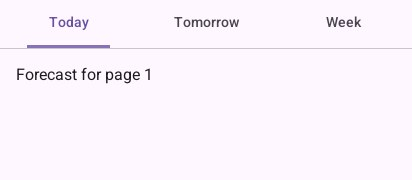
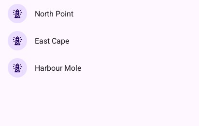

# Gestures

A finger is followed from where it comes down; the way it goes first decides who takes it (a list
for up and down, the innermost sideways piece for sideways), so these pieces nest freely.

## `Carousel` and `MultiBrowseCarousel`

A row of tiles slid sideways, gliding on and settling at a tile. The program keeps a
`material.Carousel`. `CarouselItem(height, tint, icon, title)` and `CarouselPicture(picture,
height, title)` are ready tiles. `MultiBrowseCarousel` shows large tiles, then a medium and a
small one, growing as they come in.

```go
places := []string{"Cliffs", "Harbour", "Reef", "Dunes", "Island"}
tints := []draw2d.Color{draw2d.Hex("#b3d4e0"), draw2d.Hex("#c9e0b3"), draw2d.Hex("#e0cdb3"), draw2d.Hex("#e0b3c4"), draw2d.Hex("#c4b3e0")}
look.SectionTitle("Places")
look.Carousel("places", &carousel, len(places), 140, func(index int) {
	look.CarouselItem(160, tints[index], "map-pin", places[index])
})
```



## `TabPager`

Tabs over pages a finger swipes from side to side, the underline following them. The program
keeps a `material.Pager`; `pager.Selected` is the page on show.

```go
look.TabPager("pages", []string{"Today", "Tomorrow", "Week"}, &pager, func(index int) {
	padded(look, func() {
		look.Text(fmt.Sprint("Forecast for page ", index+1), 16, draw2d.Regular, look.Scheme.OnSurface)
	})
})
```



## `PullToRefresh` and `SwipeToDismiss`

A list that refreshes when pulled past its top and let go (it returns `true` then; keep
`refreshing` true until done), and rows a finger slides away (true when gone).

```go
if look.PullToRefresh("lights", refreshing, ui.Layout{Width: ui.Grow(), Height: ui.Grow()}, func() {
	for index := 0; index < len(names); index++ {
		look.Context.Push(names[index])
		if look.SwipeToDismiss("swipe", func() {
			look.ListItem("row", material.Item{Icon: "lighthouse", Headline: names[index]})
		}) {
			names = append(names[:index], names[index+1:]...) // swiped away
			index--
		}
		look.Context.Pop()
	}
}) {
	refreshing = true // pulled down and let go: refresh, then set it back to false
}
```



## `LongPressed`

Whether the piece drawn just before was held for half a second: the phone buzzes. A list starts
choosing rows with it.

```go
touched := look.ListItem("row", material.Item{Headline: light.name, Selected: light.chosen})
switch {
case look.LongPressed():
	light.chosen = true // start choosing
case touched && choosing:
	light.chosen = !light.chosen
case touched:
	navigation.Go(light.name)
}
```

## `Stick`

An on-screen stick for walking or driving with a thumb. The finger that comes down on it holds it;
`stick.Forward` and `stick.Sideways` go from -1 to 1. Other fingers stay free, to turn a view
(`look.Context.Touches()`, leaving out `stick.Touching(touch)`).

```go
look.Stick("walk", &stick, 120)
walker.Steer(stick.Forward, stick.Sideways, step) // go-renderer's camera.Walk
```

---

[← Progress](progress.md) · [Components](README.md)
