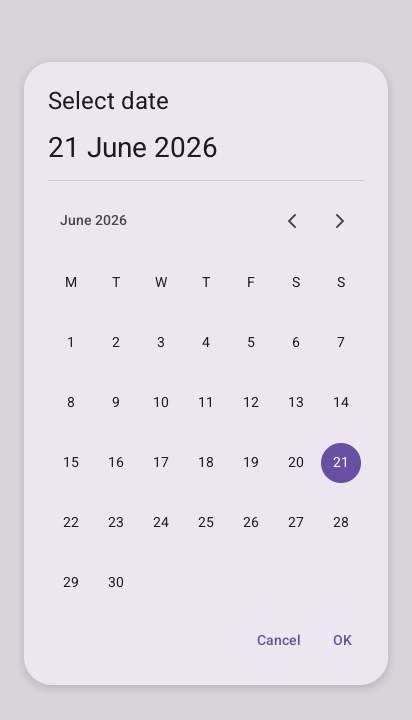
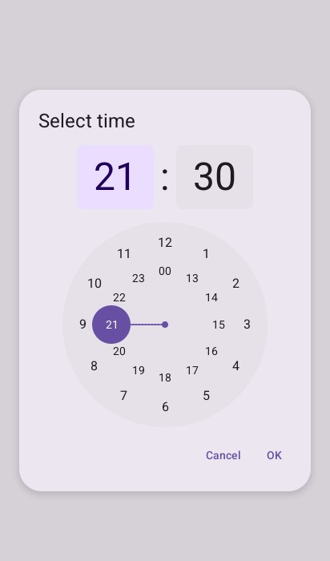

# Pickers

Both are dialogs: show them while choosing, and they answer `Open`, `Confirmed` or `Dismissed`.
They edit a `time.Time` only when confirmed. The program keeps a picker struct while it is shown.

## `DatePicker`

A day chosen a month at a time, with arrows to the months before and after.

```go
if open {
	switch look.DatePicker("inspection", &picker, &date) {
	case material.Confirmed: // date holds the day chosen
		open = false
	case material.Dismissed:
		open = false
	}
}
```



`picker.Names` (a `material.DateNames`) gives the month and day names in another language.

## `TimePicker`

Material's dial: the hours 1 to 12 round it and 13 to 00 inside, then the minutes; touched or
dragged round.

```go
if open && look.TimePicker("light at", &picker, &date) != material.Open {
	open = false // Confirmed: date has the time chosen
}
```



---

[← Overlays](overlays.md) · [Progress →](progress.md)
